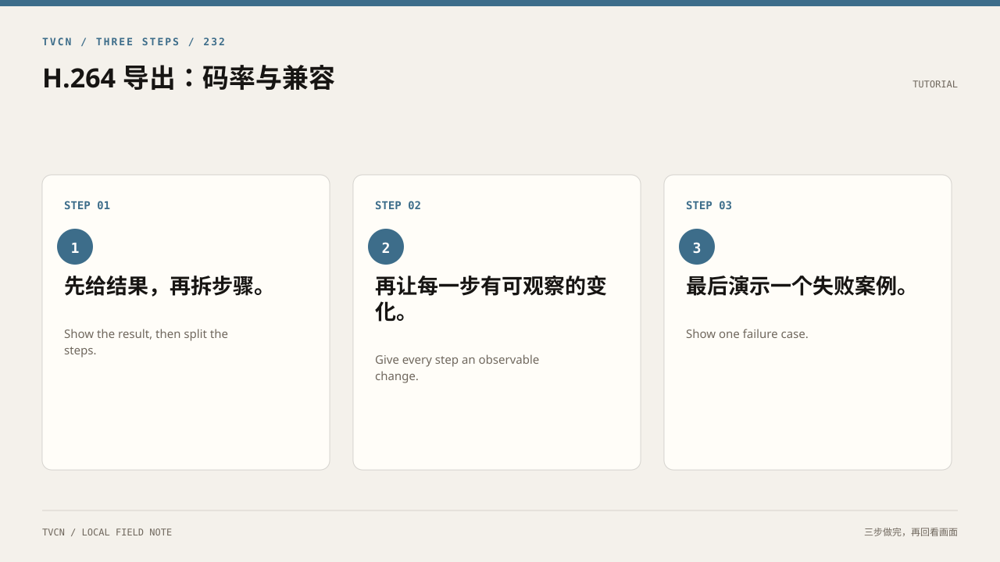

H.264 导出先定平台和码率，再选两遍编码；码率太低，运动画面先烂。

<!-- DIAGRAM_START -->
<h2>图解</h2>
<figure>
  
  <figcaption>把三步按顺序做完，再回看画面或文件。</figcaption>
</figure>
<!-- DIAGRAM_END -->
<h2>现场</h2>

平台 1080p 用 10 到 16 Mbps，4K 用 35 到 45 Mbps；两遍编码，音频 AAC 192 kbps。

<h2>怎么做</h2>

H.264 导出先定平台和码率，再选两遍编码；码率太低，运动画面先烂。
<ol><li>1080p 用 10 到 16 Mbps，4K 用 35 到 45 Mbps。</li><li>两遍编码。</li><li>音频 AAC 192 kbps。</li></ol>
<h2>别踩</h2>

别用 5 Mbps 传 4K；一有运动，画面就糊成块。

<h2>验收</h2>
<ul><li>分辨率对应码率在建议区间内。</li><li>编码方式为两遍，不是单遍赶时间。</li><li>音频 AAC 192 kbps，声画同步。</li></ul>
