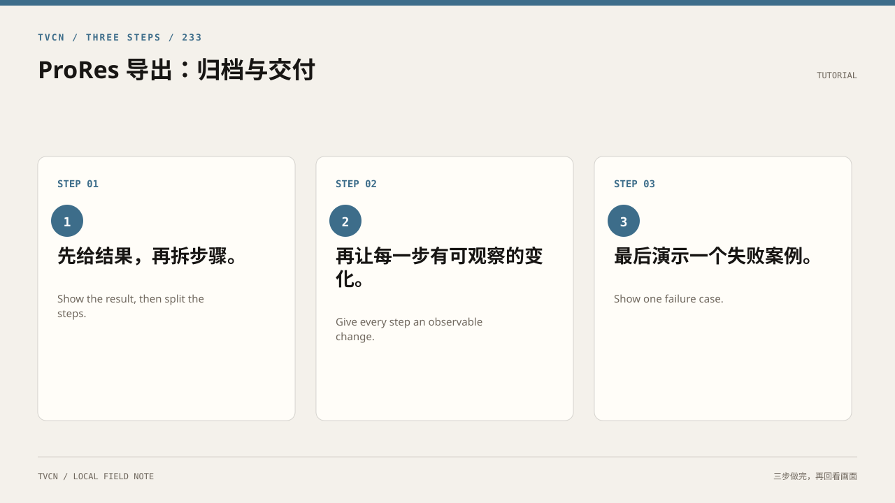

别把 ProRes 当平台交付格式；上传一半就会被压回 H.264。

<!-- DIAGRAM_START -->
<h2>图解</h2>
<figure>
  
  <figcaption>看“归档用 ProRes 422 HQ”和“交付用 422”两处，判断这个参数能不能对应到一个具体的拍摄问题。</figcaption>
</figure>
<!-- DIAGRAM_END -->
<section><h2 id="section-1">现场</h2>
归档用 ProRes 422 HQ，交付用 422；不要给平台传 ProRes，文件太大。
</section><section><h2 id="section-2">怎么做</h2><ol><li>归档用 ProRes 422 HQ。</li><li>交付用 422。</li><li>不要给平台传 ProRes，文件太大。</li></ol></section><section></section><section><h2 id="section-4">三种原因</h2>
针对“ProRes 导出：归档与交付”，先按三个方向排查；每次只改一个变量，改完录 30 秒对比，看变化跟着哪个环节走。

<table class="data-table"><thead><tr><th>原因</th><th>现场信号</th><th>5 分钟验证</th></tr></thead><tbody><tr><td>用错 profile</td><td>把 ProRes 422 LT 当母版，调色一拉就断</td><td>归档用 422 HQ 或 4444</td></tr><tr><td>色彩空间不对</td><td>Log/Rec.709 标签错，进后期偏色</td><td>按项目色彩流程选</td></tr><tr><td>存储不够</td><td>ProRes 文件大，写到一半失败</td><td>预留 2 倍空间并校验</td></tr></tbody></table>
</section><section><h2 id="section-5">现场诊断</h2><ol><li>看目标：是归档、调色中间片还是网络交付。</li><li>用 MediaInfo 检查 profile、色彩标签、音频通道。</li><li>在目标 NLE 里导入，确认无需转码、无偏色。</li></ol></section><section><h2 id="section-6">修法</h2>
ProRes 是中间片/归档格式，不是网络交付格式。先确定它在流程里的位置，再选 profile。
<ol><li>归档/调色：ProRes 422 HQ；需要 alpha 或极致：4444。</li><li>代理/粗剪：ProRes Proxy 或 422 LT，不要用于最终母版。</li><li>保留源帧率、色彩空间和音频通道，不要在这一步改。</li><li>导出后做 checksum，确认文件完整。</li></ol></section><section><h2 id="section-7">失败案例</h2>
处理“ProRes 导出：归档与交付”时，下面三种做法会更糟；先选一个替换动作，别同时改三个变量。

<table class="data-table"><thead><tr><th>失败做法</th><th>为什么会更糟</th><th>替换动作</th></tr></thead><tbody><tr><td>拿 ProRes 上传平台</td><td>文件巨大，平台拒收或转码</td><td>网络交付另出 H.264</td></tr><tr><td>用 LT 当母版</td><td>调色空间不足，暗部断层</td><td>母版用 HQ</td></tr><tr><td>忽略音频</td><td>ProRes 里音频通道错，后期才发现</td><td>导出前检查</td></tr></tbody></table>
</section><section><h2 id="section-8">验收表</h2>
验收不是“感觉好了”，是这四项都能指认、能回放、能记录。

<table class="data-table"><thead><tr><th>验收项</th><th>通过线</th><th>记录</th></tr></thead><tbody><tr><td>Profile</td><td>与流程位置匹配</td><td>MediaInfo</td></tr><tr><td>色彩</td><td>标签与项目一致</td><td>导入 NLE</td></tr><tr><td>完整性</td><td>checksum 一致，可解码到最后一帧</td><td>校验</td></tr><tr><td>音频</td><td>通道/采样率正确</td><td>单独监听</td></tr></tbody></table>
</section><section><h2>判断</h2>
这一页的判断只看三条可观察的验收，不靠口号：
<ul><li><strong>1.</strong> 归档文件是 ProRes 422 HQ，能再次调色。</li><li><strong>2.</strong> 客户交付是 422，体积在合同范围内。</li><li><strong>3.</strong> 平台上传版另做了 H.264，没有直接传 ProRes。</li></ul></section><section><h2>失败</h2>
下面任一条出现，先停，不要靠后期补：
<ul><li><strong>1.</strong> 只做到“归档文件是 ProRes 422 HQ，能再次调色”的形式，换一个机位或场景就重现不了。</li><li><strong>2.</strong> 把“客户交付是 422，体积在合同范围内”留到后期或口头解释，现场没有留下能复查的记录。</li><li><strong>3.</strong> 第 3 条验收“平台上传版另做了 H.264，没有直接传 ProRes”没人复核，交片时才发现。</li></ul></section><section><h2>延伸</h2>
<strong>10 分钟练习：</strong>用现有器材做 60 秒测试，只测“归档用 ProRes 422 HQ”；记下两个数字：一个是你需要的，一个是器材实际给出的。
</section>
<h2>验收</h2><ul><li>归档文件是 ProRes 422 HQ，能再次调色。</li><li>客户交付是 422，体积在合同范围内。</li><li>平台上传版另做了 H.264，没有直接传 ProRes。</li></ul>

<section><h2>边界</h2>
本页只解决「ProRes 导出：归档与交付」这一个问题；不替代 开机曝光检查：波形、斑马、假色、监视器：亮度、波形、LUT、构图：先让观众知道看哪里。如果现场问题属于后者，先读对应页，不要在本页继续加参数。
</section>
<!-- SOURCES_START -->
## 参考与延伸阅读

- [S65] [ITU-T H.264](https://www.itu.int/rec/T-REC-H.264/en) — 2026-11-26 访问。用于核对「现场」一节的术语/方法/规则（H.264 编码标准，不是平台上传规则）；不核对其中由本页经验得出的数字、型号与现场结论，也不替代测试。
- [S29] [YouTube：上传编码建议](https://support.google.com/youtube/answer/1722171) — 2026-11-26 访问。用于核对「怎么做」一节的术语/方法/规则（YouTube 上传编码建议，不是创作标准）；不核对其中由本页经验得出的数字、型号与现场结论，也不替代测试。
<!-- SOURCES_END -->

