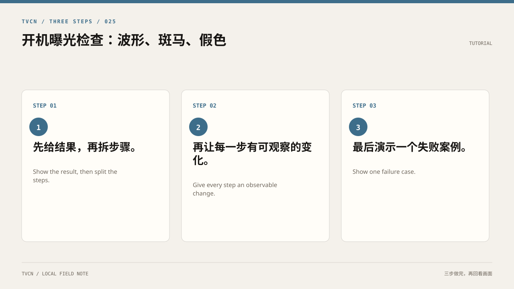

开机曝光检查按顺序：波形看分布、斑马看高光、伪色看人脸；三个都过再开拍。

<!-- DIAGRAM_START -->
<h2>图解</h2>
<figure>
  
  <figcaption>把三步按顺序做完，再回看画面或文件。</figcaption>
</figure>
<!-- DIAGRAM_END -->
<h2>现场</h2>

开机前拍 10 秒测试：波形看高光、斑马 95% 看脸、伪色看天空；三项都过再拍第一条。

<h2>怎么做</h2>

开机曝光检查按顺序：波形看分布、斑马看高光、伪色看人脸；三个都过再开拍。
<ol><li>开机前拍 10 秒测试。</li><li>波形看高光，斑马 95% 看脸，伪色看天空。</li><li>三项都过再拍第一条。</li></ol>
<h2>别踩</h2>

别只看机内屏幕；高光一过，后期拉不回来。

<h2>验收</h2>
<ul><li>10 秒测试里波形、斑马、伪色三项都看过。</li><li>高光没有超过波形顶部，脸在斑马 95% 以内。</li><li>三项通过后才拍第一条，有测试文件。</li></ul>
