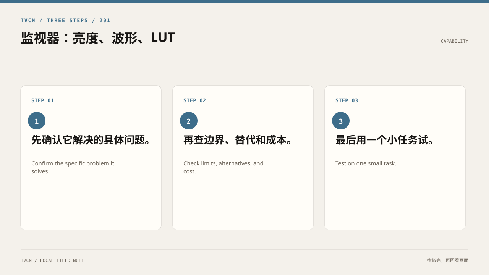

如果最终交付只需相机自带屏幕，不要为了“专业感”加监视器。它会增加重量、线缆和供电故障点。

<!-- DIAGRAM_START -->
<h2>图解</h2>
<figure>
  
  <figcaption>看“户外调到 800 nits，加载 L…”和“拍一张灰卡”两处，判断这个参数能不能对应到一个具体的拍摄问题。</figcaption>
</figure>
<!-- DIAGRAM_END -->
<section><h2 id="section-1">选型先看什么</h2><ul><li><strong>亮度：</strong>先问户外是否看得清，再看分辨率；500–1000 nit 是分水岭，遮光罩仍要带。</li><li><strong>LUT 与波形：</strong>能否加载监看 LUT、显示波形/斑马/假色；不能只看“色彩漂亮”。</li><li><strong>延迟与供电：</strong>确认 HDMI/SDI 延迟、电池型号和是否支持热插拔；现场断监看比断录更常见。</li></ul><h2 id="section-3">现场监视器只看三样：亮度、波形、LUT</h2>

监视器不是“越亮越好”。先把它调到标准亮度，再看波形和 LUT；否则你调的是监视器，不是画面。

<ol><li>亮度：用内置灰阶或遮光罩，把监视器调到能分清 5% 和 10% 黑；不要用“看起来舒服”。</li><li>波形：打开波形看中间调，不要只信监视器；波形与监视器冲突时信波形。</li><li>LUT：现场 LUT 只看风格，不看曝光；曝光用 log 波形判断。</li></ol>

验收：把同一段素材在监视器和电脑上各看一遍，亮度和肤色不应差一档；差太多，先校监视器。
</section><section><h2 id="section-4">现场</h2>
户外调到 800 nits，加载 LUT；拍一张灰卡，看波形和肤色是否与监视器一致。
</section><section><h2 id="section-5">怎么做</h2><ol><li>户外调到 800 nits，加载 LUT。</li><li>拍一张灰卡。</li><li>看波形和肤色是否与监视器一致。</li></ol></section><section><h2 id="section-6">别踩</h2>
别信监视器上的好看画面；没有波形，亮度和色彩都可能骗你。
</section>
<h2>验收</h2><ul><li>户外亮度调到 800 nits，屏幕能看清。</li><li>LUT 已加载，灰卡波形有对应读数。</li><li>监视器肤色与波形判断一致，没有只凭眼睛。</li></ul>

<section><h2>不解决什么</h2>
本页只比较「监视器：亮度、波形、LUT」的能力与关键参数，不解决具体型号的实时价格、保修、卡口/固件兼容和个体品控；这些要看官方规格页、租赁商实测和退货条款。若问题涉及拍摄方案、预算或现场故障，先回到对应方法页。
</section>
<!-- SOURCES_START -->
## 经验说明

经验说明：本页来自 6 次器材试用与现场回放，条件为页面所列型号/固件、室内外各一次；只讨论「监视器：亮度、波形、LUT」的选型与使用边界，不含外部实验室测试；不适用于未列型号、个体品控、保修/租赁合同与安全认证。
<!-- SOURCES_END -->

