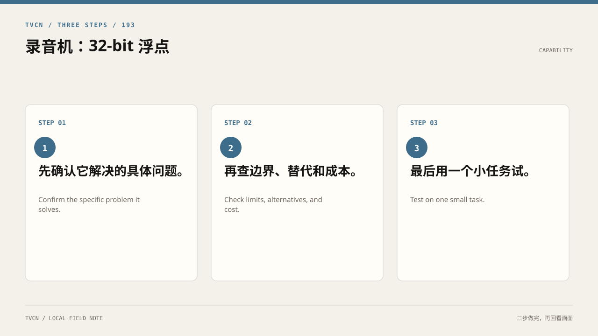

32-bit 浮点录音能救回削波，但救不回被风吞掉的对白；麦克风和位置还是第一位。

<!-- DIAGRAM_START -->
<h2>图解</h2>
<figure>
  
  <figcaption>把三步按顺序做完，再回看画面或文件。</figcaption>
</figure>
<!-- DIAGRAM_END -->
<h2>现场</h2>

录一段小声对白，峰值开到 -12 dB；再故意削波一次，回放看 32-bit 能否救回。

<h2>怎么做</h2>

32-bit 浮点录音能救回削波，但救不回被风吞掉的对白；麦克风和位置还是第一位。
<ol><li>录一段小声对白，峰值开到 -12 dB。</li><li>故意削波一次，回放看 32-bit 能否救回。</li><li>再试风噪，确认它救不回风。别把浮点当保险。</li></ol>
<h2>别踩</h2>

别把 32-bit 当万能保险；风噪和位置错误，它一样救不回来。

<h2>验收</h2>
<ul><li>小声对白峰值在 -12 dB 左右，底噪可听。</li><li>故意削波后 32-bit 能恢复可懂度。</li><li>风噪测试证明浮点救不回被风吞掉的对白。</li></ul>
