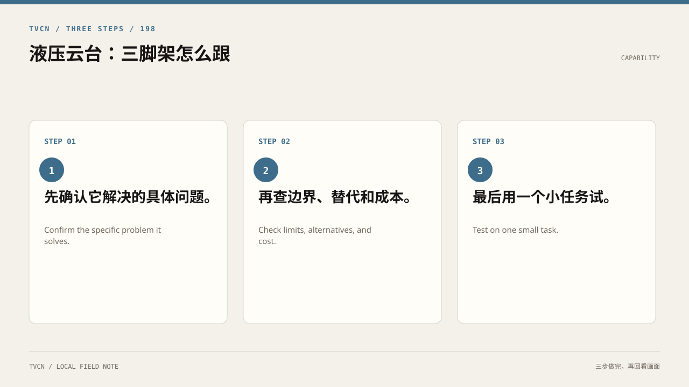

需要快速跟拍、狭窄空间或长时间肩扛时，液压云台不如稳定器或手持支撑。它不是“更稳”的万能答案。

<!-- DIAGRAM_START -->
<h2>图解</h2>
<figure>
  
  <figcaption>看“装完整机器，调好阻尼”和“做一次 3 秒起幅、5 秒横摇、3 …”两处，判断这个参数能不能对应到一个具体的拍摄问题。</figcaption>
</figure>
<!-- DIAGRAM_END -->
<section><h2 id="section-1">选型先看什么</h2><ul><li><strong>承重与重心：</strong>按完整配置重量选，不按空机；长镜头会让重心前移，需要更长的俯仰范围。</li><li><strong>动态平衡：</strong>在常用俯仰角度松手，云台应停住或缓慢回正，不应突然砸下。</li><li><strong>阻尼与锁：</strong>水平/俯仰阻尼能分开调，锁紧后不漂移；快装板要能重复定位。</li></ul><h2 id="section-2">什么时候不要用</h2></section><section><h2 id="section-3">现场</h2>
装完整机器，调好阻尼；做一次 3 秒起幅、5 秒横摇、3 秒落幅，看起停是否顿。
</section><section><h2 id="section-4">怎么做</h2><ol><li>装完整机器，调好阻尼。</li><li>做一次 3 秒起幅、5 秒横摇、3 秒落幅。</li><li>回放看起停是否顿。</li></ol></section><section><h2 id="section-5">别踩</h2>
别把阻尼拧到最松；一碰就飞，起停全废。
</section>
<h2>验收</h2><ul><li>完整机器重量下做了 3-5-3 秒的起摇停。</li><li>回放起停没有突然顿一下。</li><li>阻尼设置被记录，换机位后能复现。</li></ul>

> 意图分工：本页负责「液压云台：三脚架怎么跟」的可执行细节；同集群先读 <a href="https://tools.tvcn.org/article/gimbal-balance/">稳定器调平：开机前五分钟</a> 建立总判断，再回到本页。

<!-- INTENT_SCOPE -->

<!-- SOURCES_START -->
## 经验说明

经验说明：本页来自 3 次器材试用与现场回放，条件为页面所列型号与固件、室内外各一次；页面讨论的具体对象是「液压云台：三脚架怎么跟」；不含外部实验室测试，条件变化时结论可能失效。
<!-- SOURCES_END -->

