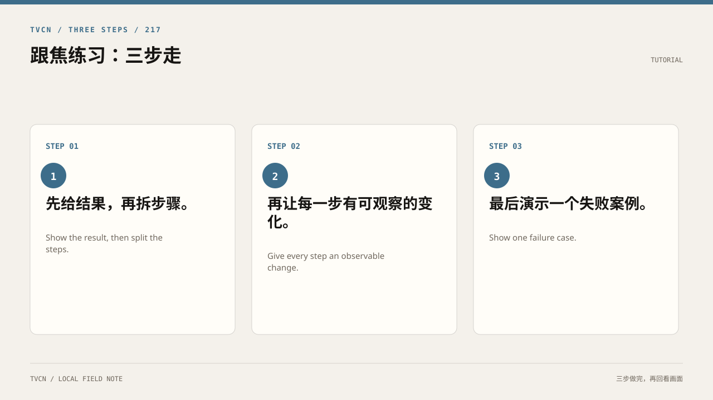

跟焦练习三步：先做标记、盯住演员的胸口、呼吸别跟着手抖。

<!-- DIAGRAM_START -->
<h2>图解</h2>
<figure>
  
  <figcaption>把三步按顺序做完，再回看画面或文件。</figcaption>
</figure>
<!-- DIAGRAM_END -->
<h2>现场</h2>

在 1 米、2 米、3 米贴标记，让助手按 1-2-3-2-1 走；练 10 次，焦点误差小于 5 厘米。

<h2>怎么做</h2>

跟焦练习三步：先做标记、盯住演员的胸口、呼吸别跟着手抖。
<ol><li>在 1 米、2 米、3 米贴标记。</li><li>让助手按 1-2-3-2-1 走。</li><li>练 10 次，焦点误差小于 5 厘米。</li></ol>
<h2>别踩</h2>

别盯嘴；嘴会转，胸口不会突然消失。

<h2>验收</h2>
<ul><li>1、2、3 米有地面标记，顺序是 1-2-3-2-1。</li><li>十次练习里至少八次误差小于 5 厘米。</li><li>跟焦时看的是胸口，不是嘴。</li></ul>
