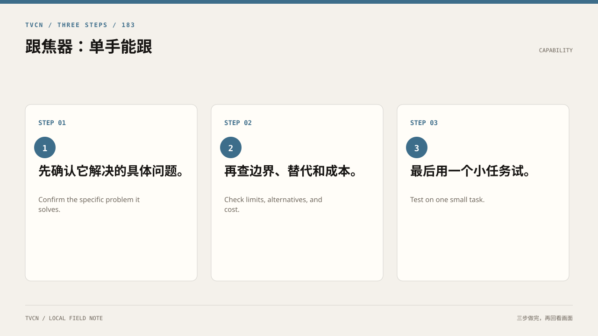

跟焦器让焦点变化有刻度、有手感；自动对焦在暗处和快速运动时不一定靠得住。

<!-- DIAGRAM_START -->
<h2>图解</h2>
<figure>
  
  <figcaption>把三步按顺序做完，再回看画面或文件。</figcaption>
</figure>
<!-- DIAGRAM_END -->
<h2>现场</h2>

先在地面标 1 米、1.5 米、2 米三个距离；让助手走位，练 10 次跟焦，误差不超过 5 厘米。

<h2>怎么做</h2>

跟焦器让焦点变化有刻度、有手感；自动对焦在暗处和快速运动时不一定靠得住。
<ol><li>地面标 1 米、1.5 米、2 米三个距离。</li><li>让助手走位，练 10 次跟焦。</li><li>误差控制在 5 厘米以内。</li></ol>
<h2>别踩</h2>

别只靠自动对焦；暗处和快速走位时它会把焦点送给背景。

<h2>验收</h2>
<ul><li>三个距离在地面有清晰标记。</li><li>十次跟焦里至少八次误差小于 5 厘米。</li><li>能指出自动对焦失败的那一次发生在什么条件。</li></ul>
