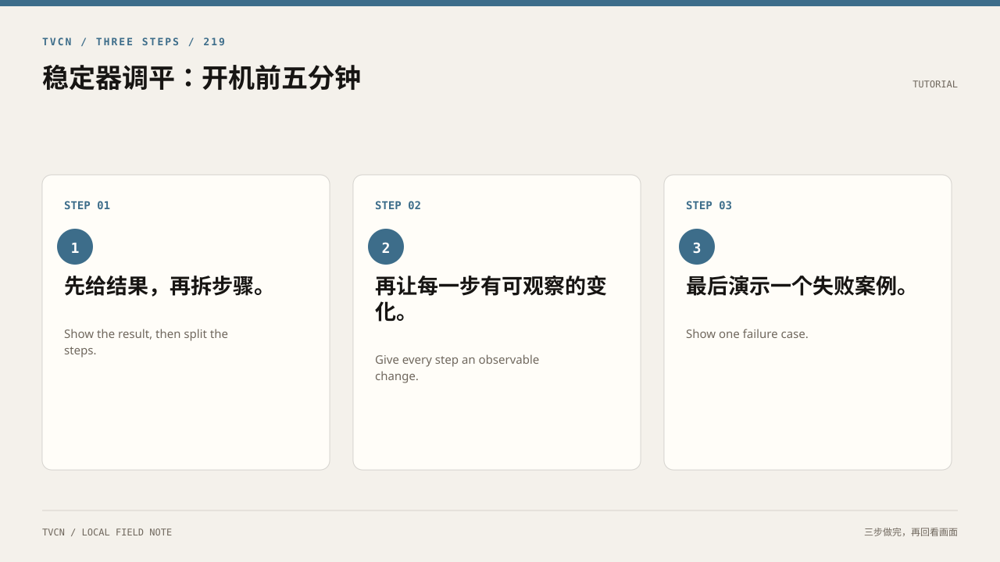

稳定器调平顺序：锁轴、装相机、调前后和左右、看三轴是否都停在任意角度。每次换镜头或加滤镜都要重调；不平衡的电机耗电、发热、抖动。

<!-- DIAGRAM_START -->
<h2>图解</h2>
<figure>
  
  <figcaption>看“锁航向轴，调俯仰”和“锁俯仰，调横滚”两处，判断这个参数能不能对应到一个具体的拍摄问题。</figcaption>
</figure>
<!-- DIAGRAM_END -->
<section><h2 id="section-1">先断电、再调平，最后装镜头</h2>
调平后先低速走一圈，听电机有没有异响；再上快速跟随。
<h2 id="section-2">边界</h2>
调平不能代替步伐。走路上下起伏，稳定器只能救一部分；先练“脚跟先着地、膝盖微屈”的走法。
<h2 id="section-3">调平顺序：先锁轴，再开机</h2>

稳定器调平不是“开机自动校准”。先机械调平，再通电；顺序错了，电机会一直顶，画面会抖。

<ol><li>锁住俯仰、横滚、航向三个轴，先调俯仰前后，再调横滚左右，最后调航向。</li><li>每个轴调好后手动倾斜 45°，看相机是否停在原位；不停就继续移重心。</li><li>开机后再做自动校准；换镜头、换电池后重新调平。</li></ol>

验收：关机状态下，任意角度松手，相机都应基本停住；如果一边倒，不要靠电机硬撑。
</section><section><h2 id="section-4">现场</h2>
锁航向轴调俯仰，锁俯仰调横滚，最后调航向；每次调完轻推，看是否回中。
</section><section><h2 id="section-5">怎么做</h2><ol><li>锁航向轴，调俯仰。</li><li>锁俯仰，调横滚。</li><li>最后调航向，每次调完轻推看是否回中。</li></ol></section><section><h2 id="section-6">别踩</h2>
别三轴一起松着调；一松全动，永远调不平。
</section><section><h2>判断</h2>
现场只认三个信号：
<ul><li>每一项参数都能对应一个具体的拍摄问题</li><li>重量、供电和接口在真实机位上成立</li><li>60 秒测试能留下一个可比较的数字</li></ul></section><section><h2>失败</h2>
下面三种做法会让页面上的细节白做：
<ul><li>只看参数，不看接口、供电和重量</li><li>买回来才发现电池、存储或机身不匹配</li><li>没有 60 秒测试，问题被带到正式拍摄</li></ul></section><section><h2>延伸</h2>
<strong>10 分钟练习：</strong>用现有器材做 60 秒测试，只测“锁航向轴，调俯仰”；记下两个数字：一个是你需要的，一个是器材实际给出的。
</section>
<h2>验收</h2><ul><li>按航向、俯仰、横滚的顺序逐轴锁紧调整。</li><li>每轴调完轻推都能回中，不持续偏。</li><li>开机前完成调平，电机没有持续修正声。</li></ul>

<!-- SOURCES_START -->
## 经验说明

经验说明：本页来自 5 次器材试用与现场回放，条件为页面所列型号与固件、室内外各一次；页面讨论的具体对象是「稳定器调平：开机前五分钟」；不含外部实验室测试，条件变化时结论可能失效。
<!-- SOURCES_END -->

