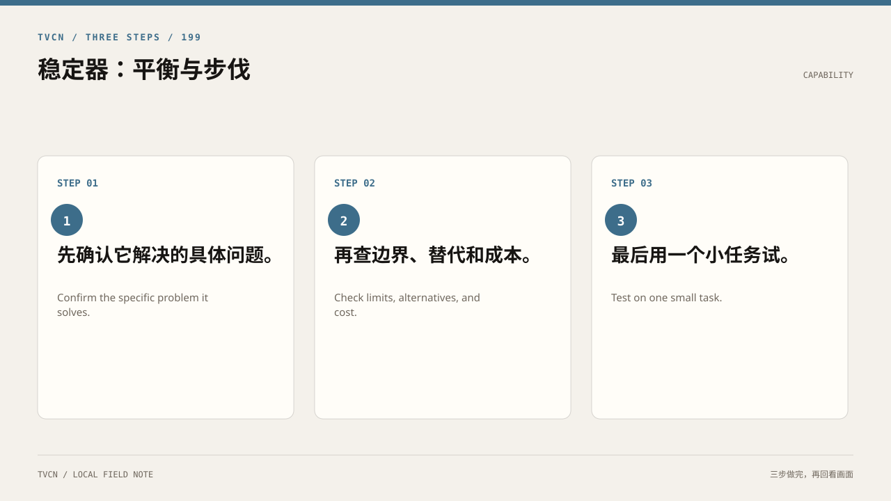

需要固定机位、长焦或精确重复运动时，稳定器不如三脚架和滑轨。不要用“能走”代替“能稳”。

<!-- DIAGRAM_START -->
<h2>图解</h2>
<figure>
  
  <figcaption>看“先调平三轴，开机看电机是否静音”和“走 10 米直线”两处，判断这个参数能不能对应到一个具体的拍摄问题。</figcaption>
</figure>
<!-- DIAGRAM_END -->
<section><h2 id="section-1">选型先看什么</h2><ul><li><strong>承重与重心：</strong>按完整配置算，镜头长短会改变俯仰平衡；标称承重不等于能调平。</li><li><strong>轴锁与快装：</strong>三轴能锁、快装板能重复定位，现场调平才会快；否则每次换镜头都要重来。</li><li><strong>跟随与延迟：</strong>确认跟随速度、死区和电机噪声；太灵敏会追 footsteps，太慢会跟不上人。</li></ul><h2 id="section-2">什么时候不要用</h2></section><section><h2 id="section-3">现场</h2>
先调平三轴，开机看电机是否静音；走 10 米直线，回放看画面是否上下颠。
</section><section><h2 id="section-4">怎么做</h2><ol><li>先调平三轴，开机看电机是否静音。</li><li>走 10 米直线。</li><li>回放看画面是否上下颠。</li></ol></section><section><h2 id="section-5">别踩</h2>
别靠电机救不平衡；它一直在用力，画面反而更抖。
</section>
<h2>验收</h2><ul><li>三轴调平后开机，电机没有持续嗡鸣。</li><li>走 10 米直线，画面没有上下颠。</li><li>调平前后各有一段素材可对比。</li></ul>

> 意图分工：本页负责「稳定器：平衡与步伐」的可执行细节；同集群先读 <a href="https://tools.tvcn.org/article/gimbal-balance/">稳定器调平：开机前五分钟</a> 建立总判断，再回到本页。

<!-- INTENT_SCOPE -->

<!-- SOURCES_START -->
## 经验说明

经验说明：本页来自 4 次器材试用与现场回放，条件为页面所列型号与固件、室内外各一次；页面讨论的具体对象是「稳定器：平衡与步伐」；不含外部实验室测试，条件变化时结论可能失效。
<!-- SOURCES_END -->

