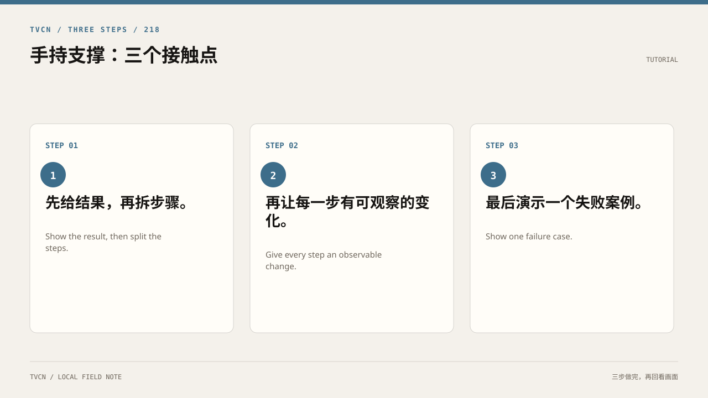

双手握机，肘贴肋骨，取景器贴眉骨；脚与肩同宽，膝盖微屈。移动时脚跟先着地，身体带着相机走，不要手臂单独晃。

<!-- DIAGRAM_START -->
<h2>图解</h2>
<figure>
  
  <figcaption>看“胸口抵住机背，肘夹肋”和“左手托镜头，形成第三点”两处，判断这个参数能不能对应到一个具体的拍摄问题。</figcaption>
</figure>
<!-- DIAGRAM_END -->
<section><h2 id="section-1">手持先锁肘，再谈呼吸</h2>
用广角比长焦稳；需要长焦时，找墙、桌或膝盖做支点，不要硬扛。
<h2 id="section-2">边界</h2>
手持不是越稳越好。完全不动会像三脚架，失去现场感；保留一点呼吸，但不要上下跳。
<h2 id="section-3">手持三个接触点</h2>

手持不稳，通常不是臂力不够，是身体没有形成三角支撑。把双肘夹在肋骨两侧，相机贴住胸口，第三点用肩带或颈部拉紧。

<ol><li>双脚与肩同宽，膝盖微屈；移动时先迈脚，再让身体跟，不要用腰甩。</li><li>呼吸在镜头开始时屏住 3–5 秒，不要全程憋气；长镜头在动作间隙换气。</li><li>广角比长焦更容易稳；没有防抖时，用 35mm 以下、快门 1/50 以上。</li></ol>

验收：拍 10 秒固定主体，回放看边缘是否呼吸；如果画面在跳，先检查第三点，而不是换稳定器。
</section><section><h2 id="section-4">现场</h2>
三点支撑：胸口抵住机背、肘夹肋、左手托镜头；拍 10 秒静态，回放看呼吸起伏。
</section><section><h2 id="section-5">怎么做</h2><ol><li>胸口抵住机背，肘夹肋。</li><li>左手托镜头，形成第三点。</li><li>拍 10 秒静态，回放看呼吸起伏。</li></ol></section><section><h2 id="section-6">别踩</h2>
别双臂伸直举机；两个接触点撑不住，十秒就开始晃。
</section><section><h2>判断</h2>
现场只认三个信号：
<ul><li>每一项参数都能对应一个具体的拍摄问题</li><li>重量、供电和接口在真实机位上成立</li><li>60 秒测试能留下一个可比较的数字</li></ul></section><section><h2>失败</h2>
下面三种做法会让页面上的细节白做：
<ul><li>只看参数，不看接口、供电和重量</li><li>买回来才发现电池、存储或机身不匹配</li><li>没有 60 秒测试，问题被带到正式拍摄</li></ul></section><section><h2>延伸</h2>
<strong>10 分钟练习：</strong>用现有器材做 60 秒测试，只测“胸口抵住机背，肘夹肋”；记下两个数字：一个是你需要的，一个是器材实际给出的。
</section>
<h2>验收</h2><ul><li>胸口、肘、左手三个接触点都建立。</li><li>10 秒静态回放只有轻微呼吸，没有大晃。</li><li>双臂没有伸直举机，重心靠近身体。</li></ul>
