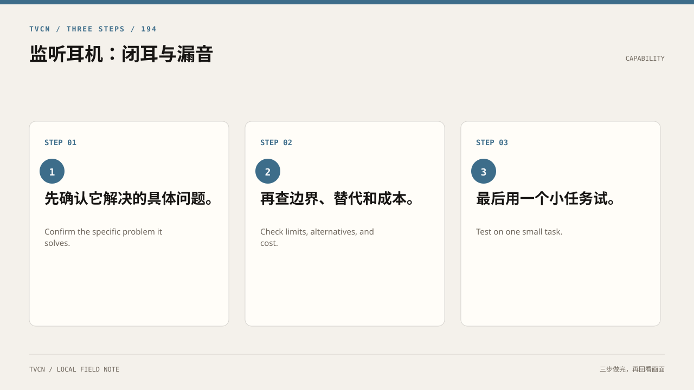

只靠耳机判断音质不够；它不能替代电平表和房间测试。不要用消费耳机低频加重来判断对白。

<!-- DIAGRAM_START -->
<h2>图解</h2>
<figure>
  
  <figcaption>看“戴封闭耳机听 30 秒环境声”和“如果听见自己的呼吸，说明耳机漏音或麦…”两处，判断这个参数能不能对应到一个具体的拍摄问题。</figcaption>
</figure>
<!-- DIAGRAM_END -->
<section><h2 id="section-1">选型先看什么</h2><ul><li><strong>封闭与漏音：</strong>拍摄现场用封闭式，避免耳机声进麦；开放式只适合混音。</li><li><strong>阻抗与灵敏度：</strong>手机或相机直推要低阻高灵敏；高阻耳机需要耳放。</li><li><strong>线材与备份：</strong>可换线、长线和转接头；现场断线要能替换。</li></ul><h2 id="section-2">什么时候不要用</h2></section><section><h2 id="section-3">现场</h2>
戴封闭耳机听 30 秒环境声；如果听见自己的呼吸，说明耳机漏音或麦克风太近。
</section><section><h2 id="section-4">怎么做</h2><ol><li>戴封闭耳机听 30 秒环境声。</li><li>如果听见自己的呼吸，说明耳机漏音或麦克风太近。</li><li>换贴合耳罩再听一遍。</li></ol></section><section><h2 id="section-5">别踩</h2>
别用蓝牙降噪耳机监听；它会把底噪和齿音都美化掉。
</section>
<h2>验收</h2><ul><li>监听用的是封闭式耳机，不是消费蓝牙。</li><li>30 秒环境声里没有自己的呼吸或耳罩漏音。</li><li>耳罩贴合，换姿势后底噪判断不变。</li></ul>

<!-- SOURCES_START -->
## 经验说明

经验说明：本页来自 5 次器材试用与现场回放，条件为页面所列型号与固件、室内外各一次；页面讨论的具体对象是「监听耳机：闭耳与漏音」；不含外部实验室测试，条件变化时结论可能失效。
<!-- SOURCES_END -->

