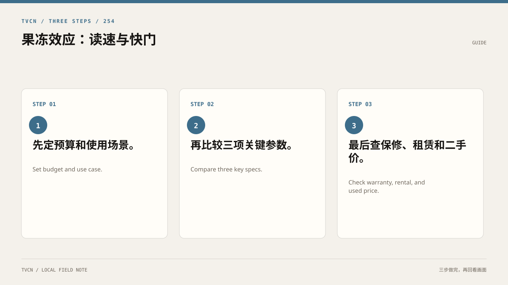

滚动快门在横向快速移动时最明显：柱子变斜、脸变窄、手变软。拍前避免快速横摇，用更广的镜头、更稳的支撑；后期稳定只能裁切，不能还原形状。

<!-- DIAGRAM_START -->
<h2>图解</h2>
<figure>
  
  <figcaption>看“拍横摇栏杆或窗框，回放看直线弯不弯”和“换读出更快的机器，或用全局快门”两处，判断这个参数能不能对应到一个具体的拍摄问题。</figcaption>
</figure>
<!-- DIAGRAM_END -->
<section><h2 id="section-1">果冻先看“运动方向”</h2>
需要快速运动时，用全局快门机型或降低运动速度；不要靠后期“修复”严重变形。
<h2 id="section-2">边界</h2>
轻微果冻可以接受。观众不会逐帧看柱子；只要动作读得懂，不必为此重拍全部。
</section><section><h2 id="section-3">现场</h2>
拍快速横摇栏杆，回放看直线弯曲；换机器或开全局快门，不能靠后期修。
</section><section><h2 id="section-4">怎么做</h2>
果冻效应来自慢读出加快运动；先换机器或全局快门，再调快门。
<ol><li>拍横摇栏杆或窗框，回放看直线弯不弯。</li><li>换读出更快的机器，或用全局快门。</li><li>减少快速横摇，改用固定机位和慢摇。</li></ol></section><section><h2 id="section-5">别踩</h2>
别只怪镜头；CMOS 读出速度才是主因。
</section><section><h2>判断</h2>
这一页的判断只看三条可观察的验收，不靠口号：
<ul><li><strong>1.</strong> 横摇栏杆或窗框拍过，回放看过直线弯不弯。</li><li><strong>2.</strong> 换了快读出机器或全局快门。</li><li><strong>3.</strong> 快速横摇减少，改用固定机位或慢摇。</li></ul></section><section><h2>失败</h2>
下面任一条出现，先停，不要靠后期补：
<ul><li><strong>1.</strong> 只做到“横摇栏杆或窗框拍过，回放看过直线弯不弯”的形式，换一个机位或场景就重现不了。</li><li><strong>2.</strong> 把“换了快读出机器或全局快门”留到后期或口头解释，现场没有留下能复查的记录。</li><li><strong>3.</strong> 别只怪镜头；CMOS 读出速度才是主因。</li></ul></section><section><h2>延伸</h2>
<strong>10 分钟练习：</strong>用现有器材做 60 秒测试，只测“拍横摇栏杆或窗框，回放看直线弯不弯”；记下两个数字：一个是你需要的，一个是器材实际给出的。
</section>
<h2>验收</h2><ul><li>横摇栏杆或窗框拍过，回放看过直线弯不弯。</li><li>换了快读出机器或全局快门。</li><li>快速横摇减少，改用固定机位或慢摇。</li></ul>

<!-- SOURCES_START -->
## 参考与延伸阅读

- [S23] [SMPTE 标准入口](https://www.smpte.org/standards) — 2026-11-26 访问。用于核对首段“果冻效应来自慢读出和快速运动；先换机器，再调快门，别只怪镜头。”中的术语与公开背景（时间码、色彩、影院与信号链标准的机构入口）；不替代现场测试。
- [S52] [ARRI：ALEXA 35](https://www.arri.com/en/camera-systems/cameras/legacy-camera-systems/alexa-35) — 2026-11-26 访问。用于核对首段“果冻效应来自慢读出和快速运动；先换机器，再调快门，别只怪镜头。”中的术语与公开背景（摄影机规格、Log-C 与色彩流程）；不替代现场测试。
<!-- SOURCES_END -->

