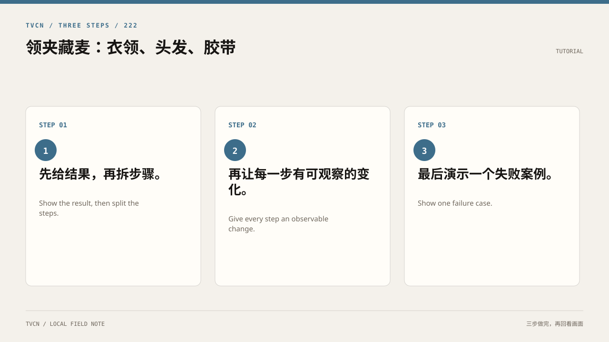

领夹麦最怕衣服摩擦和布料遮住。把麦头固定在衣领内侧，线与皮肤之间留一层胶带，外套和纽扣远离麦头；不要直接把麦塞进头发或围巾。

<!-- DIAGRAM_START -->
<h2>图解</h2>
<figure>
  
  <figcaption>看“先藏衣领，再藏头发”和“用医用胶带做减震”两处，判断这个参数能不能对应到一个具体的拍摄问题。</figcaption>
</figure>
<!-- DIAGRAM_END -->
<section><h2 id="section-1">藏麦先保“不摩擦”，再保“看不见”</h2>
录一条让演员转头、抬手、坐下，回放听有没有沙沙声；有，就换位置，不要靠后期降噪。
<h2 id="section-2">边界</h2>
看不见不等于听得好。藏得太深会闷、会远；宁可露一点麦头，也要保住对白清楚。
<h2 id="section-3">领夹藏麦：离嘴 15–20cm，先防衣服</h2>

领夹最怕衣服摩擦和遮挡。别在领口正中，放在锁骨下方 15–20cm，用医用胶带做一个小拱，让线不贴布料。

<ol><li>麦头朝上，不要压在纽扣或拉链下；毛衣、围巾先测试摩擦声。</li><li>线沿衣服内侧走，过腰带时留一个松弯；不要拉直，拉直会把衣服摩擦传进麦。</li><li>再放一个备用录音机在口袋，作为保险；两台设备对一下时间。</li></ol>

验收：让演员左右转头、抬手、坐下，回放听有没有摩擦和遮挡；有，先改位置，不要靠降噪。
</section><section><h2 id="section-4">现场</h2>
先藏衣领，再藏头发；用医用胶带做减震，别用普通胶带撕衣服。
</section><section><h2 id="section-5">怎么做</h2><ol><li>先藏衣领，再藏头发。</li><li>用医用胶带做减震。</li><li>别用普通胶带，撕衣服还留胶。</li></ol></section><section><h2 id="section-6">别踩</h2>
别把领夹塞进衣领就完事；衣料摩擦声会盖住对白。
</section><section><h2>判断</h2>
这一页的判断只看三条可观察的验收，不靠口号：
<ul><li><strong>1.</strong> 领夹先试衣领，再试头发，位置有记录。</li><li><strong>2.</strong> 固定用医用胶带，没有普通胶带。</li><li><strong>3.</strong> 换装后重新藏麦，摩擦声测试通过。</li></ul></section><section><h2>失败</h2>
下面任一条出现，先停，不要靠后期补：
<ul><li><strong>1.</strong> 只做到“领夹先试衣领，再试头发，位置有记录”的形式，换一个机位或场景就重现不了。</li><li><strong>2.</strong> 把“固定用医用胶带，没有普通胶带”留到后期或口头解释，现场没有留下能复查的记录。</li><li><strong>3.</strong> 别把领夹塞进衣领就完事；衣料摩擦声会盖住对白。</li></ul></section><section><h2>延伸</h2>
<strong>10 分钟练习：</strong>用现有器材做 60 秒测试，只测“先藏衣领，再藏头发”；记下两个数字：一个是你需要的，一个是器材实际给出的。
</section>
<h2>验收</h2><ul><li>领夹先试衣领，再试头发，位置有记录。</li><li>固定用医用胶带，没有普通胶带。</li><li>换装后重新藏麦，摩擦声测试通过。</li></ul>

<!-- SOURCES_START -->
## 参考与延伸阅读

- [S35] [Avid 资源中心](https://www.avid.com/resource-center) — 2026-11-26 访问。用于核对首段“领夹藏麦先试衣领，再试头发，最后用医用胶带固定；每换一件衣服都要重藏。”中的术语与公开背景（Media Composer、协作与交付的资源入口）；不替代现场测试。
- [S27] [ITU-R：BS.1770 音频响度与真峰值测量](https://www.itu.int/rec/R-REC-BS.1770/en) — 2026-11-27 访问。用于核对首段“领夹藏麦先试衣领，再试头发，最后用医用胶带固定；每换一件衣服都要重藏。”中的术语与公开背景（响度测量、真峰值与 EBU R128 所依据的 ITU 算法标准）；不替代现场测试。
<!-- SOURCES_END -->

