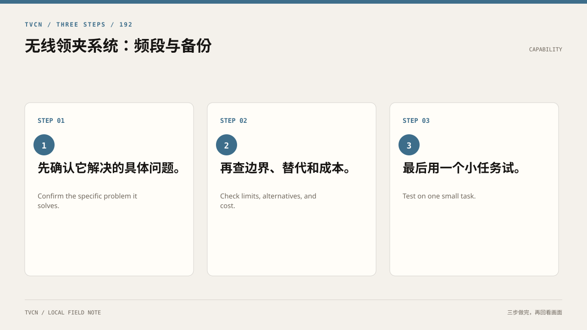

无线领夹先查频段和干扰，再录一条备用轨；现场没有第二次机会。

<!-- DIAGRAM_START -->
<h2>图解</h2>
<figure>
  
  <figcaption>把三步按顺序做完，再回看画面或文件。</figcaption>
</figure>
<!-- DIAGRAM_END -->
<h2>现场</h2>

现场扫频 2 分钟，选干净频段；发射器藏后腰，录一条 32-bit 备份。

<h2>怎么做</h2>

无线领夹先查频段和干扰，再录一条备用轨；现场没有第二次机会。
<ol><li>现场扫频 2 分钟，选干净频段。</li><li>发射器藏后腰，线走衣内。</li><li>录一条 32-bit 备份轨。</li></ol>
<h2>别踩</h2>

别用出厂频段直接开录；现场干扰一撞，整条对白就废。

<h2>验收</h2>
<ul><li>现场做了 2 分钟扫频，干净频段有记录。</li><li>发射器藏在后腰，线没有露在衣外。</li><li>主轨之外有一条 32-bit 备份，能独立使用。</li></ul>
