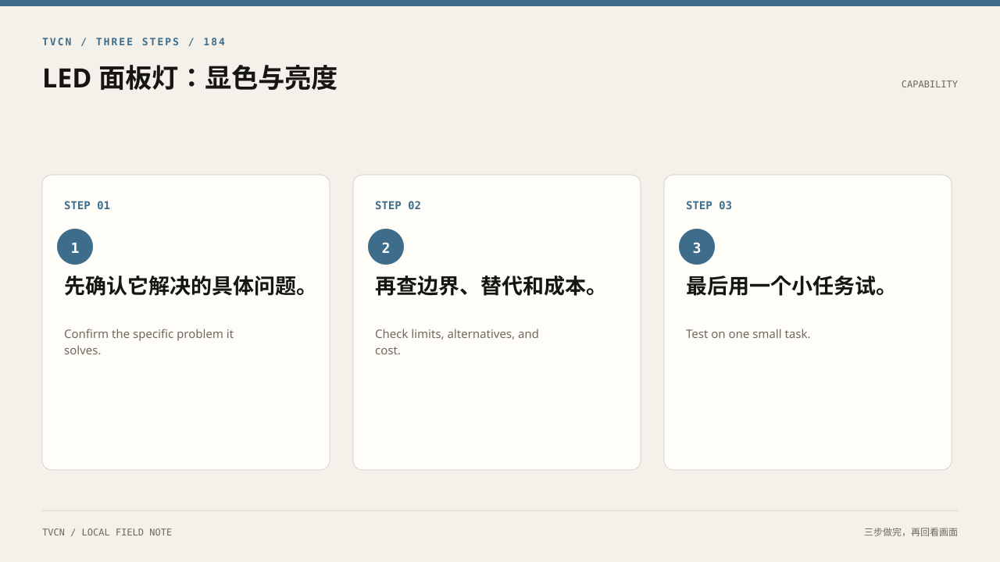

需要强方向、远距离或大面积时，面板灯的输出和控光不如 COB 加柔光箱。它适合近距、低功率和快速布置。

<!-- DIAGRAM_START -->
<h2>图解</h2>
<figure>
  
  <figcaption>看“灯调到 5600K、100%，拍白纸…”和“看手背是否发绿”两处，判断这个参数能不能对应到一个具体的拍摄问题。</figcaption>
</figure>
<!-- DIAGRAM_END -->
<section><h2 id="section-1">选型先看什么</h2><ul><li><strong>显色：</strong>拍肤色、红布和绿植，确认 CRI/TLCI 标称之外的真实表现；便宜面板常把绿色推脏。</li><li><strong>调光：</strong>从高到低扫一遍，找闪烁、色偏和跳档；低亮拍摄时尤其明显。</li><li><strong>柔光与控光：</strong>面板自带柔光布是否均匀，能否加格栅；边缘漏光会在近距打脸时露馅。</li></ul><h2 id="section-2">什么时候不要用</h2></section><section><h2 id="section-3">现场</h2>
把灯调到 5600K、100%，拍一张白纸和手背；看手背是否发绿，再测 1 米照度。
</section><section><h2 id="section-4">怎么做</h2><ol><li>灯调到 5600K、100%，拍白纸和手背。</li><li>看手背是否发绿。</li><li>再测 1 米照度，决定它够不够当主光。</li></ol></section><section><h2 id="section-5">别踩</h2>
别看瓦数买灯；显色不对，再亮也只能当补光。
</section>
<h2>验收</h2><ul><li>5600K 全功率下白纸和手背有样张。</li><li>手背偏绿或偏品红能被指出。</li><li>1 米照度有数值，能判断是否够主光。</li></ul>

> 意图分工：本页负责「LED 面板灯：显色与亮度」的可执行细节；同集群先读 <a href="https://tools.tvcn.org/article/buy-light-kit/">购买灯光套装：先买柔，再买亮</a> 建立总判断，再回到本页。

<!-- INTENT_SCOPE -->

<!-- SOURCES_START -->
## 经验说明

经验说明：本页来自 6 次器材试用与现场回放，条件为页面所列型号与固件、室内外各一次；页面讨论的具体对象是「LED 面板灯：显色与亮度」；不含外部实验室测试，条件变化时结论可能失效。
<!-- SOURCES_END -->

