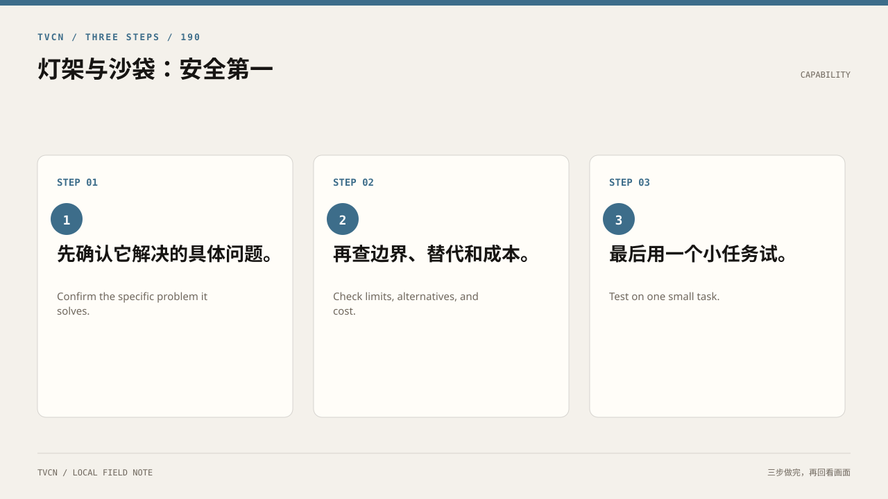

灯架先放沙袋，再升灯；一根没配重的灯架，倒下来比灯贵。

<!-- DIAGRAM_START -->
<h2>图解</h2>
<figure>
  
  <figcaption>把三步按顺序做完，再回看画面或文件。</figcaption>
</figure>
<!-- DIAGRAM_END -->
<h2>现场</h2>

每个灯架挂 2 个沙袋，升到最高后轻推一下；不晃才开机，晃就降下来。

<h2>怎么做</h2>

灯架先放沙袋，再升灯；一根没配重的灯架，倒下来比灯贵。
<ol><li>每个灯架挂 2 个沙袋。</li><li>升到最高后轻推一下。</li><li>不晃才开机，晃就降下来或加配重。</li></ol>
<h2>别踩</h2>

别先升灯再找沙袋；升到最高再配重，已经有人扶不住了。

<h2>验收</h2>
<ul><li>每个灯架有两个沙袋，袋重有记录。</li><li>升到最高后轻推不晃。</li><li>有晃动的灯架已经降高或加配重，没有带病开机。</li></ul>
