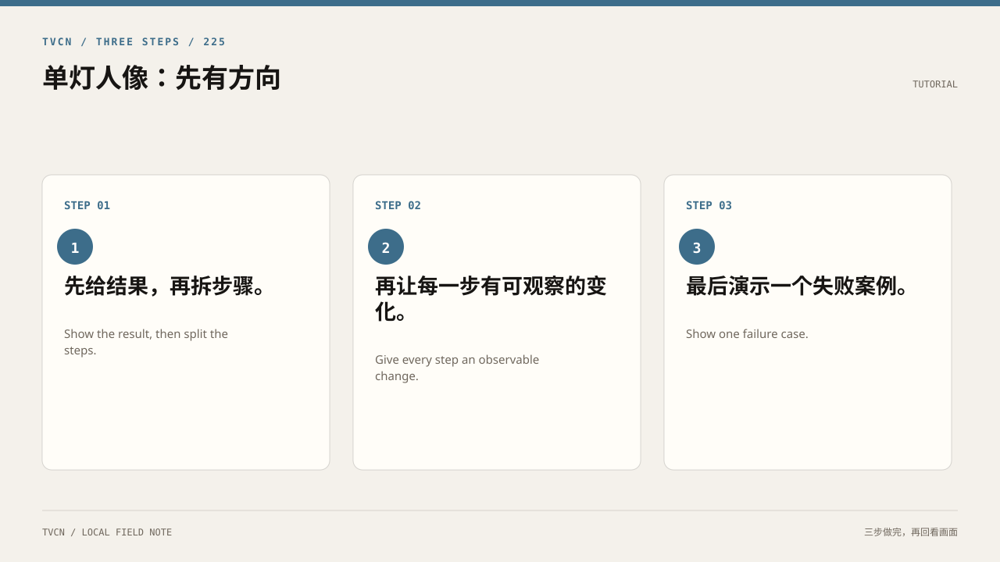

只有一盏灯时，先决定它从哪来：侧后方做轮廓，侧前方做脸，顶光做压迫。方向定错，加十盏灯也救不回来。补光用白墙、泡沫板或反光板，不要再加第二盏同方向的灯。

<!-- DIAGRAM_START -->
<h2>图解</h2>
<figure>
  
  <figcaption>看“灯放 45 度，距人脸 1 米”和“先拍一张看鼻子影子”两处，判断这个参数能不能对应到一个具体的拍摄问题。</figcaption>
</figure>
<!-- DIAGRAM_END -->
<section><h2 id="section-1">一盏灯先定方向，再用反光补</h2>
拍一条，看鼻子和下巴的阴影；阴影形状决定观众读到的情绪。
<h2 id="section-2">边界</h2>
单灯不是“平”。可以用黑旗压暗另一侧，让反差更大；不要为了省事把灯怼到正面，脸会变平。
<h2 id="section-3">单灯人像：先有方向，再有亮度</h2>

一盏灯也能有层次，关键是方向和距离。灯放在主体侧前方 45°，距离 1–1.5 米；另一侧用白墙或反光板补一点，比例控制在 2:1。

<ol><li>先关掉所有环境光，只开主灯；看鼻子和下巴的阴影是否朝同一方向。</li><li>灯越高，眼窝越深；不要高过发际线，否则会出现“鬼影”。</li><li>需要柔光就加柔光箱或白布，尺寸越接近人脸越柔；不要直接裸灯打脸。</li></ol>

验收：看暗部是否还有皮肤纹理；一片死黑说明补光不够，一片平说明主灯太正。两者之间才有形状。
</section><section><h2 id="section-4">现场</h2>
灯放 45 度，距人脸 1 米；先拍一张看鼻子影子，再决定柔光箱大小。
</section><section><h2 id="section-5">怎么做</h2><ol><li>灯放 45 度，距人脸 1 米。</li><li>先拍一张看鼻子影子。</li><li>再决定柔光箱大小。</li></ol></section><section><h2 id="section-6">别踩</h2>
别先换柔光箱；方向没定，换多大的箱子都只是换一种错。
</section><figure class="article-audio"><audio controls preload="none" src="../../assets/audio/zh/tool-lighting-one-light.zh.mp3"></audio><figcaption>20 秒语音演示：一个检查点和最常见的失败。文字稿与步骤在正文里。</figcaption></figure><section><h2>判断</h2>
这一页的判断只看三条可观察的验收，不靠口号：
<ul><li><strong>1.</strong> 灯在 45 度、距人脸 1 米，有位置记录。</li><li><strong>2.</strong> 鼻子影子方向明确，能看出光从哪来。</li><li><strong>3.</strong> 柔光箱大小是在方向确认后才决定的。</li></ul></section><section><h2>失败</h2>
下面任一条出现，先停，不要靠后期补：
<ul><li><strong>1.</strong> 只做到“灯在 45 度、距人脸 1 米，有位置记录”的形式，换一个机位或场景就重现不了。</li><li><strong>2.</strong> 把“鼻子影子方向明确，能看出光从哪来”留到后期或口头解释，现场没有留下能复查的记录。</li><li><strong>3.</strong> 别先换柔光箱；方向没定，换多大的箱子都只是换一种错。</li></ul></section><section><h2>延伸</h2>
<strong>10 分钟练习：</strong>用现有器材做 60 秒测试，只测“灯放 45 度，距人脸 1 米”；记下两个数字：一个是你需要的，一个是器材实际给出的。
</section>
<h2>验收</h2><ul><li>灯在 45 度、距人脸 1 米，有位置记录。</li><li>鼻子影子方向明确，能看出光从哪来。</li><li>柔光箱大小是在方向确认后才决定的。</li></ul>

> 意图分工：本页负责「单灯人像：先有方向」的可执行细节；同集群先读 <a href="https://tools.tvcn.org/article/buy-light-kit/">购买灯光套装：先买柔，再买亮</a> 建立总判断，再回到本页。

<!-- INTENT_SCOPE -->

<!-- SOURCES_START -->
## 经验说明

经验说明：本页来自 7 个制作项目的操作复盘，条件为页面所列软件/机型版本与交付平台；只讨论「单灯人像：先有方向」的操作顺序，不含外部实验室测试；不适用于未列版本、影院母版、广播级安全认证或法律意见。
<!-- SOURCES_END -->

