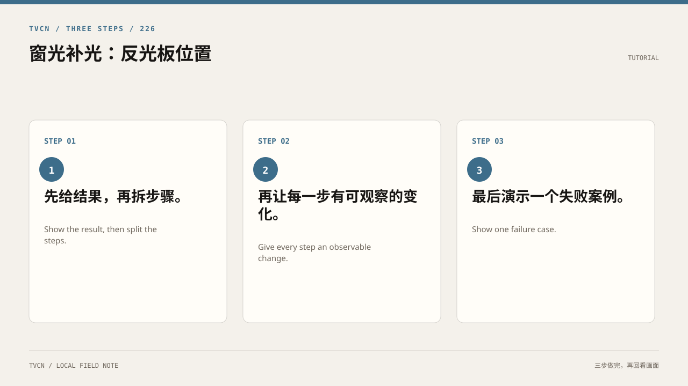

窗光不是固定光源，它会随时间变冷、变弱、变方向。先定拍摄时段，再用纱帘、百叶或反光板控制硬度和方向；不要在同一天混用早晨和下午的光。

<!-- DIAGRAM_START -->
<h2>图解</h2>
<figure>
  
  <figcaption>看“反光板放阴影侧，距人脸 1 米”和“角度 45 度”两处，判断这个参数能不能对应到一个具体的拍摄问题。</figcaption>
</figure>
<!-- DIAGRAM_END -->
<section><h2 id="section-1">窗光先看时间和方向</h2>
人物离窗越近，反差越大；想柔，就把人往后拉或加一块 diffusion。
<h2 id="section-2">边界</h2>
窗光好看但不稳定。长时间采访要准备补光，否则云一过，前后镜头接不上。
<h2 id="section-3">窗光补光：反光板放哪，放多远</h2>

窗光做主光时，反光板不是越近越好。先看窗的方向，再把板放在主体侧前方 45°，距离 0.5–1 米；太近会把暗部填平，太远没有效果。

<ol><li>白色板最通用；银色板更硬，适合需要眼神光但不想加灯的场景。</li><li>板的角度低于视线，避免把光打到鼻孔和下巴；需要柔一点就用布面或柔光布。</li><li>先拍一张只靠窗光的画面，再加板；对比暗部是否出现细节但不发灰。</li></ol>

验收：暗部有细节、亮部不过曝、皮肤不发灰。如果板一拿开画面就“死”，说明主光其实不够，先调整窗边位置。
</section><section><h2 id="section-4">现场</h2>
反光板放阴影侧，距人脸 1 米，角度 45 度；看暗部是否提亮而不过曝。
</section><section><h2 id="section-5">怎么做</h2><ol><li>反光板放阴影侧，距人脸 1 米。</li><li>角度 45 度。</li><li>看暗部是否提亮而不过曝。</li></ol></section><section><h2 id="section-6">别踩</h2>
别把反光板放窗边；那只是把亮部更亮，暗部还是黑的。
</section><section><h2>判断</h2>
这一页的判断只看三条可观察的验收，不靠口号：
<ul><li><strong>1.</strong> 反光板在阴影侧，距人脸 1 米、约 45 度。</li><li><strong>2.</strong> 暗部提亮，亮部没有过曝。</li><li><strong>3.</strong> 有反光板前后对比，阴影细节增加。</li></ul></section><section><h2>失败</h2>
下面任一条出现，先停，不要靠后期补：
<ul><li><strong>1.</strong> 只做到“反光板在阴影侧，距人脸 1 米、约 45 度”的形式，换一个机位或场景就重现不了。</li><li><strong>2.</strong> 把“暗部提亮，亮部没有过曝”留到后期或口头解释，现场没有留下能复查的记录。</li><li><strong>3.</strong> 别把反光板放窗边；那只是把亮部更亮，暗部还是黑的。</li></ul></section><section><h2>延伸</h2>
<strong>10 分钟练习：</strong>用现有器材做 60 秒测试，只测“反光板放阴影侧，距人脸 1 米”；记下两个数字：一个是你需要的，一个是器材实际给出的。
</section>
<h2>验收</h2><ul><li>反光板在阴影侧，距人脸 1 米、约 45 度。</li><li>暗部提亮，亮部没有过曝。</li><li>有反光板前后对比，阴影细节增加。</li></ul>

> 意图分工：本页负责「窗光补光：反光板位置」的可执行细节；同集群先读 <a href="https://tools.tvcn.org/article/buy-light-kit/">购买灯光套装：先买柔，再买亮</a> 建立总判断，再回到本页。

<!-- INTENT_SCOPE -->

<!-- SOURCES_START -->
## 经验说明

经验说明：本页来自 3 个制作项目的操作复盘，条件为页面所列软件/机型版本与交付平台；只讨论「窗光补光：反光板位置」的操作顺序，不含外部实验室测试；不适用于未列版本、影院母版、广播级安全认证或法律意见。
<!-- SOURCES_END -->

