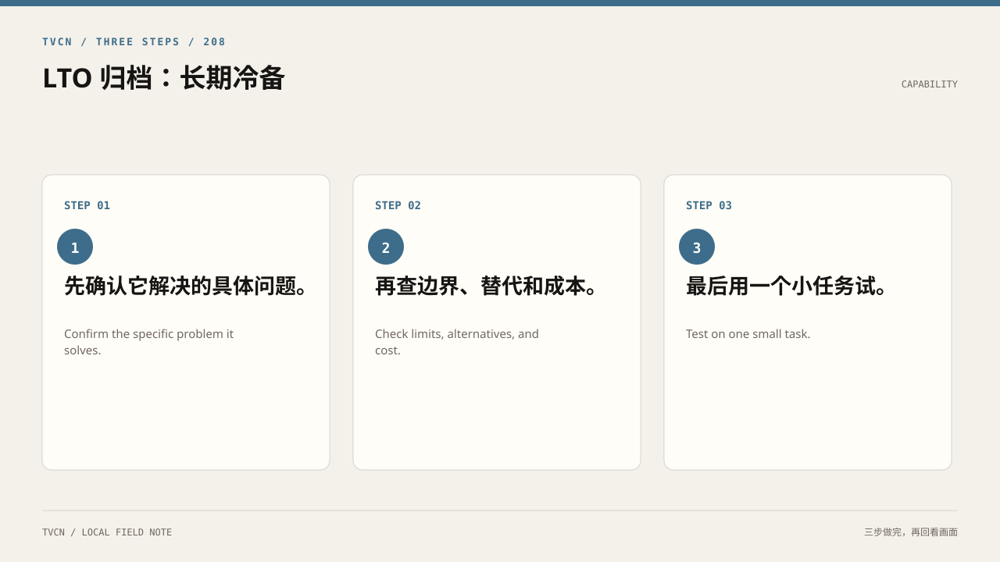

需要随机访问、频繁修改或小于 10TB 的项目，LTO 不划算。先用硬盘加云冷备，等归档规模真的上来再上磁带。

<!-- DIAGRAM_START -->
<h2>图解</h2>
<figure>
  
  <figcaption>看“先算恢复：从 LTO 拷 1 TB …”和“如果超过项目周期，别用它做工作盘”两处，判断这个参数能不能对应到一个具体的拍摄问题。</figcaption>
</figure>
<!-- DIAGRAM_END -->
<section><h2 id="section-1">选型先看什么</h2><ul><li><strong>代际兼容：</strong>确认 LTO 代际、驱动器与磁带是否互相读写；新驱动器通常能读上一代，不能读未来。</li><li><strong>软件与索引：</strong>没有目录和校验和的 LTO 只是一盘磁带；恢复时要知道文件在哪一卷、第几个分区。</li><li><strong>环境与轮换：</strong>磁带怕潮、怕尘、怕温度突变；至少两卷异地，并按计划迁移到新介质。</li></ul><h2 id="section-2">什么时候不要用</h2></section><section><h2 id="section-3">现场</h2>
先算恢复：从 LTO 拷 1 TB 到磁盘要多久；如果超过项目周期，别用它做工作盘。
</section><section><h2 id="section-4">怎么做</h2><ol><li>先算恢复：从 LTO 拷 1 TB 到磁盘要多久。</li><li>如果超过项目周期，别用它做工作盘。</li><li>再算每 TB 成本和保管条件。</li></ol></section><section><h2 id="section-5">别踩</h2>
别把 LTO 当剪辑盘；恢复 1 TB 要几小时，今天剪不完。
</section>
<h2>验收</h2><ul><li>1 TB 恢复时间有实测数字。</li><li>恢复时间与项目周期比较过，结论明确。</li><li>每 TB 成本和保管条件都有记录。</li></ul>
