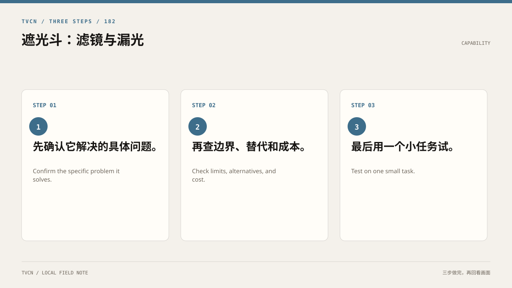

遮光斗先挡杂光，再装滤镜；便宜的遮光斗可能漏光，反而毁画面。

<!-- DIAGRAM_START -->
<h2>图解</h2>
<figure>
  
  <figcaption>把三步按顺序做完，再回看画面或文件。</figcaption>
</figure>
<!-- DIAGRAM_END -->
<h2>现场</h2>

在逆光下拍黑绒布，看遮光斗边缘漏不漏光；装滤镜后旋转，检查暗角。

<h2>怎么做</h2>

遮光斗先挡杂光，再装滤镜；便宜的遮光斗可能漏光，反而毁画面。
<ol><li>逆光下拍黑绒布，看遮光斗边缘漏不漏光。</li><li>装滤镜后旋转，检查暗角。</li><li>漏光就用黑布或胶带封边。</li></ol>
<h2>别踩</h2>

别把遮光斗当滤镜架；先查漏光，再谈插片。

<h2>验收</h2>
<ul><li>逆光黑绒布测试能看到边缘是否漏光。</li><li>滤镜旋转一圈，暗角出现的位置有记录。</li><li>漏光处已用黑布或胶带处理，不是无视。</li></ul>
