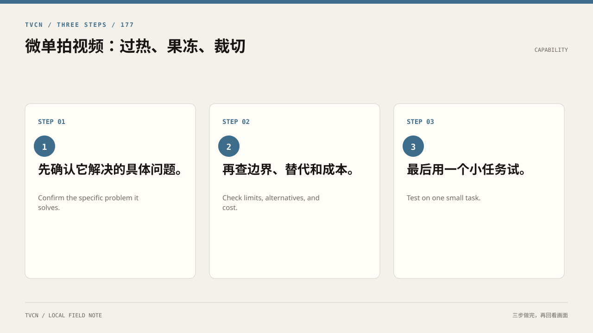

需要长时间采访、极端低光或专业音频时，微单是妥协方案；用带主动散热的机器或摄像机。不要用“电影感”掩盖过热停机。

<!-- DIAGRAM_START -->
<h2>图解</h2>
<figure>
  
  <figcaption>看“连续录 30 分钟 4K 25p，看…”和“横摇栏杆看果冻”两处，判断这个参数能不能对应到一个具体的拍摄问题。</figcaption>
</figure>
<!-- DIAGRAM_END -->
<section><h2 id="section-1">选型先看什么</h2><ul><li><strong>过热与录制限制：</strong>确认实际室温下的连续录制时间，不看厂商标称；夏天和 4K 高帧率最容易停。</li><li><strong>果冻与读出：</strong>快速摇镜和横向运动会不会倾斜；大传感器尤其要看读出速度。</li><li><strong>裁切与接口：</strong>4K 是否裁切、HDMI 是否干净输出、能否外接电源；这些决定它能不能进工作流。</li></ul><h2 id="section-2">什么时候不要用</h2></section><section><h2 id="section-3">现场</h2>
连续录 30 分钟 4K 25p，看过热警告；再横摇栏杆看果冻，切 4K 60p 看裁切。
</section><section><h2 id="section-4">怎么做</h2><ol><li>连续录 30 分钟 4K 25p，看过热警告。</li><li>横摇栏杆看果冻。</li><li>切 4K 60p，看视角是否变窄。</li></ol></section><section><h2 id="section-5">别踩</h2>
别只拍三分钟测试；过热通常在第 20 分钟才出现。
</section>
<h2>验收</h2><ul><li>连续 30 分钟 4K 25p 有温度记录或警告记录。</li><li>横摇栏杆时果冻程度可见并被描述。</li><li>4K 60p 的视角裁切有前后对比。</li></ul>

> 意图分工：本页负责「微单拍视频：过热、果冻、裁切」的可执行细节；同集群先读 <a href="https://tools.tvcn.org/article/buy-camera-budget/">购买相机：先定预算，再定机身</a> 建立总判断，再回到本页。

<!-- INTENT_SCOPE -->

<!-- SOURCES_START -->
## 经验说明

经验说明：本页来自 5 次器材试用与现场回放，条件为页面所列型号与固件、室内外各一次；页面讨论的具体对象是「微单拍视频：过热、果冻、裁切」；不含外部实验室测试，条件变化时结论可能失效。
<!-- SOURCES_END -->

