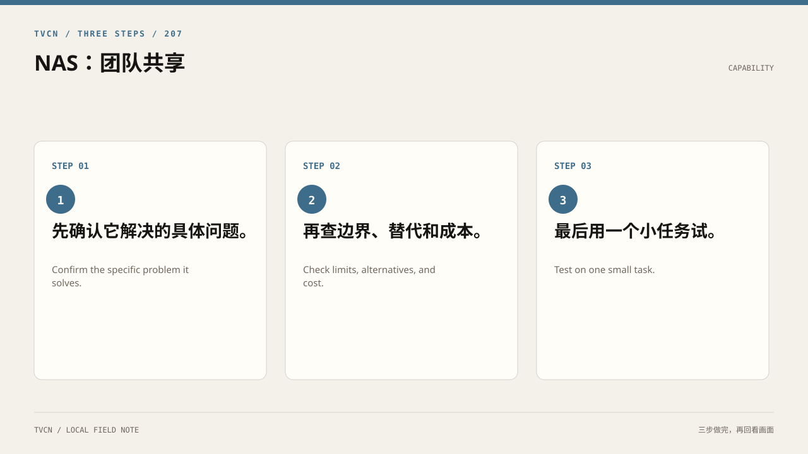

只有一个人、一个项目时，NAS 的功耗和管理成本高于直接 SSD。不要为了“团队感”提前上复杂存储。

<!-- DIAGRAM_START -->
<h2>图解</h2>
<figure>
  
  <figcaption>看“先建用户组和只读权限”和“开回收站”两处，判断这个参数能不能对应到一个具体的拍摄问题。</figcaption>
</figure>
<!-- DIAGRAM_END -->
<section><h2 id="section-1">选型先看什么</h2><ul><li><strong>盘位与冗余：</strong>至少双盘位并做镜像；单盘 NAS 不是备份，只是网络硬盘。</li><li><strong>网络：</strong>千兆只够小团队；多机位剪辑要看 2.5G/10G 网卡、交换机和线材。</li><li><strong>恢复：</strong>确认坏盘后能重建、能读旧盘；没有恢复演练的 RAID 只是心理安慰。</li></ul><h2 id="section-2">什么时候不要用</h2><h2 id="section-3">NAS 是协作盘，不是唯一备份</h2>

NAS 解决共享和版本，不解决火灾、误删和勒索软件。团队用 NAS 时，至少再加一块离线盘和一份异地副本。

<ol><li>权限按项目分：剪辑可读写，客户只读；离职人员当天移除。</li><li>开启快照，保留 7–30 天；删除前先看快照，不要直接清空回收站。</li><li>网络至少 2.5GbE 才适合多轨剪辑；千兆只够代理。</li></ol>

验收：随机抽一个上周版本，能从快照恢复；拔掉 NAS 电源，确认还有离线副本可打开。两项都过，才叫备份。
</section><section><h2 id="section-4">现场</h2>
先建用户组和只读权限，开回收站；两人同时写同一文件，测试冲突提示。
</section><section><h2 id="section-5">怎么做</h2><ol><li>先建用户组和只读权限。</li><li>开回收站。</li><li>两人同时写同一文件，测试冲突提示。</li></ol></section><section><h2 id="section-6">别踩</h2>
别给全组读写权限；两个人同时改一个文件，版本就没了。
</section>
<h2>验收</h2><ul><li>用户组和只读权限已配置，不是全员可写。</li><li>回收站开启，删除的文件能找回。</li><li>两人同写测试出现冲突提示或锁定。</li></ul>
