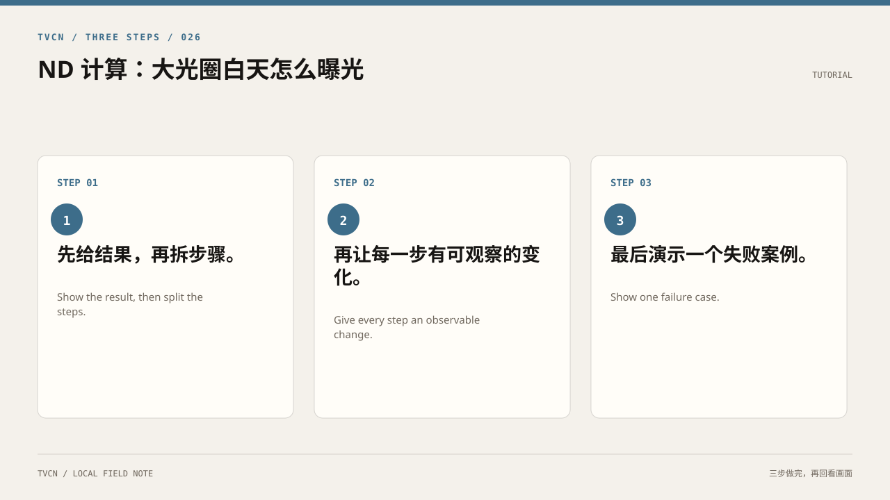

ND 计算先定快门和光圈，再算需要减几档；凭感觉换滤镜，十次有九次过暗。

<!-- DIAGRAM_START -->
<h2>图解</h2>
<figure>
  
  <figcaption>把三步按顺序做完，再回看画面或文件。</figcaption>
</figure>
<!-- DIAGRAM_END -->
<h2>现场</h2>

先定 1/50 和 f/2.8，用测光表或相机测环境 EV；再算需要减几档，换对应 ND。

<h2>怎么做</h2>

ND 计算先定快门和光圈，再算需要减几档；凭感觉换滤镜，十次有九次过暗。
<ol><li>先定 1/50 和 f/2.8。</li><li>用测光表或相机测环境 EV。</li><li>算需要减几档，换对应 ND。</li></ol>
<h2>别踩</h2>

别用“看起来差不多”换 ND；档数不对，人脸会暗两档。

<h2>验收</h2>
<ul><li>快门 1/50、光圈 f/2.8 是先定死的。</li><li>环境 EV 有测光读数，不是估的。</li><li>算出的档数与实际 ND 一致，换后曝光落在目标内。</li></ul>
