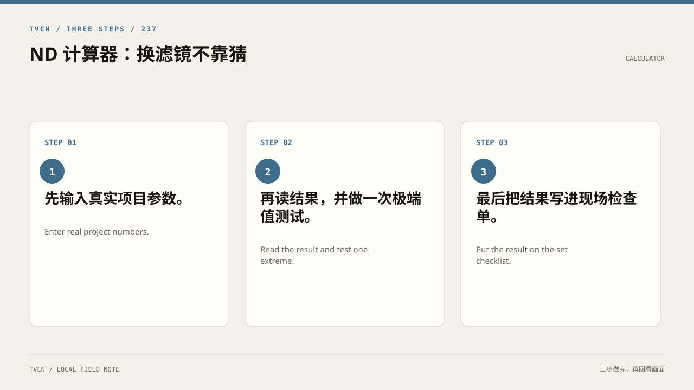

先固定光圈和 ISO，只把快门放慢到目标值；需要的减光档数是 ND 档数 = log2(当前快门 ÷ 目标快门) 。例如 1/50 放到 1/200，差 4 倍，就是 2 档。

<!-- DIAGRAM_START -->
<h2>图解</h2>
<figure>
  
  <figcaption>看“输入 1/50、f/2.8、ISO …”和“测环境 EV”两处，判断这个参数能不能对应到一个具体的拍摄问题。</figcaption>
</figure>
<!-- DIAGRAM_END -->
<section><h2 id="section-1">公式与档位</h2>
先固定光圈和 ISO，只把快门放慢到目标值；需要的减光档数是 <strong>ND 档数 = log2(当前快门 ÷ 目标快门)</strong>。例如 1/50 放到 1/200，差 4 倍，就是 2 档。
<ul><li>1 档 = 1/2 光量，2 档 = 1/4，3 档 = 1/8，10 档 = 1/1024。</li><li>常见 ND 标法：ND0.3≈1 档、ND0.6≈2 档、ND0.9≈3 档、ND1.8≈6 档、ND3.0≈10 档。</li><li>叠滤镜时档数相加，不是倍率相加；两片 3 档等于 6 档。</li></ul><h2 id="section-2">算一个现场例子</h2>
晴天想用 f/2.8、1/50、ISO 100 拍浅景深，但测光显示 1/1600 才不过曝：1/1600 ÷ 1/50 = 32 倍，log2(32)=5，需要 5 档 ND。装 ND1.5（5 档）后再把快门放回 1/50，曝光回到起点。
<h2 id="section-3">边界</h2>
公式只算曝光，不算滤镜色偏、暗角和长曝光带来的热噪。换滤镜后仍要拍一条回放，不要只看计算器。
</section><section><h2 id="section-4">现场</h2>
输入 1/50、f/2.8、ISO 100，测环境 EV；算需要几档 ND，再换滤镜。
</section><section><h2 id="section-5">怎么做</h2><ol><li>输入 1/50、f/2.8、ISO 100。</li><li>测环境 EV。</li><li>算需要几档 ND，再换滤镜。</li></ol></section><section><h2 id="section-6">别踩</h2>
别拿默认值当答案；默认值不是你的项目和光线。
</section><section class="calc-widget" data-calculator="nd-calculator">
<h2 id="section-7">ND 计算器</h2>

输入当前快门与目标快门，算出需要几档减光，并给出最接近的标准 ND。

<label class="calc-field">当前快门分母（1/s）<input type="number" inputmode="decimal" data-calc="current" data-default="50" value="50" step="1" min="1"></label><label class="calc-field">目标快门分母（1/s）<input type="number" inputmode="decimal" data-calc="target" data-default="25" value="25" step="1" min="1"></label>

<strong data-out="result">ND —</strong>两档之间优先选更少减光，再用光圈微调。

<button type="button" data-reset>恢复默认</button>

公式：档数 = log₂(当前分母 ÷ 目标分母)；ND 系数 = 2^档数。

<noscript>
JavaScript 关闭时按上方公式手算；默认值 50 → 25 约需 1 档，即 ND2。
</noscript>
</section><section><h2>替代</h2>
如果“输入 1/50、f/2.8、ISO …”不是你的主问题，先用“测环境 EV”对应的基础做法；两项都成立再考虑升级。
</section><section><h2>60 秒自测</h2>
用现有器材按“输入 1/50、f/2.8、ISO …”做一次 60 秒测试，记下一个数字；数字没有变化，就不要加预算。
</section>
<h2>验收</h2><ul><li>快门、光圈、ISO 三项输入与现场设置一致。</li><li>环境 EV 来自实测，不是猜的。</li><li>算出的 ND 档数与实际滤镜一致，曝光落在目标。</li></ul>

> 意图分工：本页负责「ND 计算器：换滤镜不靠猜」的可执行细节；同集群先读 <a href="https://tools.tvcn.org/article/nd-calculate/">ND 计算：大光圈白天怎么曝光</a> 建立总判断，再回到本页。

<!-- INTENT_SCOPE -->

<!-- SOURCES_START -->
## 经验说明

经验说明：本页来自 3 次器材试用与现场回放，条件为页面所列型号与固件、室内外各一次；页面讨论的具体对象是「ND 计算器：换滤镜不靠猜」；不含外部实验室测试，条件变化时结论可能失效。
<!-- SOURCES_END -->

