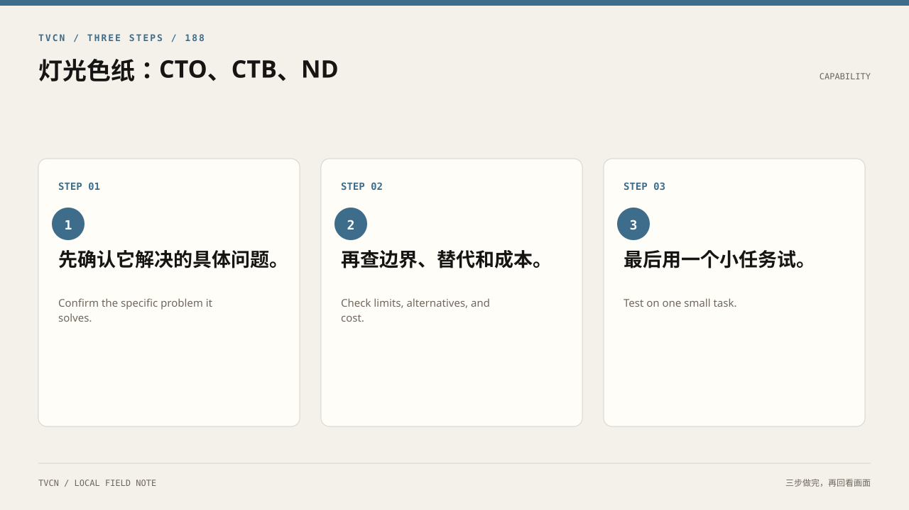

灯光色纸先分清 CTO、CTB、ND：一个加暖、一个加冷、一个减亮；贴错会改掉整个现场。

<!-- DIAGRAM_START -->
<h2>图解</h2>
<figure>
  
  <figcaption>把三步按顺序做完，再回看画面或文件。</figcaption>
</figure>
<!-- DIAGRAM_END -->
<h2>现场</h2>

把 CTO 贴窗、CTB 贴灯，拍一张看色温；ND 色纸只减亮，不改变色温。

<h2>怎么做</h2>

灯光色纸先分清 CTO、CTB、ND：一个加暖、一个加冷、一个减亮；贴错会改掉整个现场。
<ol><li>CTO 贴窗、CTB 贴灯，拍一张看色温。</li><li>ND 色纸只减亮，不改变色温。</li><li>每张色纸标名称和档数，别靠颜色认。</li></ol>
<h2>别踩</h2>

别靠肉眼分色纸；CTO 和 ND 在暗处看起来都像橙色。

<h2>验收</h2>
<ul><li>CTO 和 CTB 各有一个可对比的色温样张。</li><li>ND 色纸前后色温不变，只有亮度变化。</li><li>每张色纸有名称和档数标签。</li></ul>
