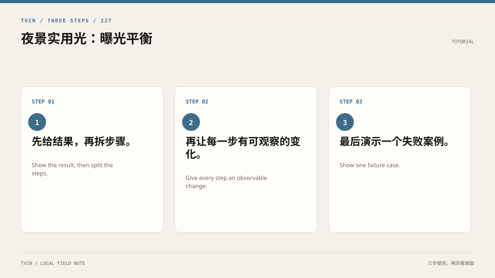

有实景灯的夜景，先让灯和窗在画面里保留颜色，不要把亮部曝到死白。人物脸用一块小补光或墙面反光提半档，剩下的暗部交给后期；现场把噪声控制住，比后期降噪更重要。

<!-- DIAGRAM_START -->
<h2>图解</h2>
<figure>
  
  <figcaption>看“让 practical 留在画面里…”和“小灯从侧面补脸”两处，判断这个参数能不能对应到一个具体的拍摄问题。</figcaption>
</figure>
<!-- DIAGRAM_END -->
<section><h2 id="section-1">夜景先保高光，再提暗部</h2>
拍一条回放，看暗部有没有色块和闪烁；有，就加一点环境光或换更高宽容度模式，不要靠后期硬拉。
<h2 id="section-2">边界</h2>
夜景不是把画面调亮。黑要黑得下去，灯要亮得起来；全画面灰亮，反而没有夜晚。
</section><section><h2 id="section-3">现场</h2>
让 practical 在画面里，亮度 30%；小灯从侧面补脸，背景保持暗。
</section><section><h2 id="section-4">怎么做</h2><ol><li>让 practical 留在画面里，亮度 30%。</li><li>小灯从侧面补脸。</li><li>背景保持暗，不要整体提亮。</li></ol></section><section><h2 id="section-5">别踩</h2>
别把整条街提亮；夜景一平，实用光就不成立了。
</section><section><h2>判断</h2>
这一页的判断只看三条可观察的验收，不靠口号：
<ul><li><strong>1.</strong> 画面里的 practical 亮度约 30%，没有过曝。</li><li><strong>2.</strong> 人脸由侧面小灯补，不是正面大平光。</li><li><strong>3.</strong> 背景保持暗，整体没有变成白天。</li></ul></section><section><h2>失败</h2>
下面任一条出现，先停，不要靠后期补：
<ul><li><strong>1.</strong> 只做到“画面里的 practical 亮度约 30%，没有过曝”的形式，换一个机位或场景就重现不了。</li><li><strong>2.</strong> 把“人脸由侧面小灯补，不是正面大平光”留到后期或口头解释，现场没有留下能复查的记录。</li><li><strong>3.</strong> 别把整条街提亮；夜景一平，实用光就不成立了。</li></ul></section><section><h2>延伸</h2>
<strong>10 分钟练习：</strong>用现有器材做 60 秒测试，只测“让 practical 留在画面里…”；记下两个数字：一个是你需要的，一个是器材实际给出的。
</section>
<h2>验收</h2><ul><li>画面里的 practical 亮度约 30%，没有过曝。</li><li>人脸由侧面小灯补，不是正面大平光。</li><li>背景保持暗，整体没有变成白天。</li></ul>

<!-- DEEP_DIVE_START -->
## 深读

<strong>约 7 分钟。</strong> 这一节不重复前面的做法，只补三个东西：两种条件、一个反例、一个可复用模型；读完能判断什么时候换做法。

### 条件 A：街头/外景

街头夜景先找“已有的实用光”：店铺灯箱、路灯、车灯、自动售货机。不要先架灯，先看现场有什么；把人物放到实用光能照到的位置，再决定补不补。实用光的方向通常不好，但可信。

街头的最大问题是色温乱：钠灯橙、LED 白、灯箱绿。先定一个主色温，把相机白平衡锁住；其他颜色保留，不要全部调白。夜色的“脏”有时候是信息。

### 条件 B：室内/小空间

室内夜景的实用光通常是台灯、屏幕、冰箱、走廊灯。先决定“哪一盏是主”，其他关掉或调暗；不要所有灯都开，房间会像白天。主灯放在人物侧后方，给轮廓；正面用一块小反光板提一点。

室内夜景容易“黑成一团”：暗部没有层次，人物和背景粘在一起。给背景留一盏低功率 practical，或在人物后方放一条窄光，分离轮廓。分离不需要亮，只需要边缘。

### 反例：实用光太亮

为了“看清楚”，团队把台灯换成 100W 灯泡，房间亮了，夜景没了。人物像在办公室，背景像白天。观众不会说“曝光不对”，会说“不像晚上”。

修法不是把灯调暗到看不见，而是换一个低功率灯泡、加柔光、把灯放远；让实用光在画面里“亮”，但照到人物身上只是半档。实用光要像生活，不像摄影灯。

### 可复用模型

<strong>实用光 → 基准 → 补光 → 分离。</strong> 先找现场的光，再定曝光基准，再补脸/动作，最后分离轮廓。四步按顺序，不要先架大灯。

每场夜戏拍一张“光位图”：实用光在哪、人物在哪、补光在哪、背景分离在哪。图比记忆可靠，换机位时不会丢方向。

<!-- DEEP_DIVE_END -->

<!-- SOURCES_START -->
## 参考与延伸阅读

- [S23] [SMPTE：标准入口](https://www.smpte.org/standards) — 2026-11-26 访问。用于核对「夜景先保高光，再提暗部」一节的术语/方法/规则（SMPTE 标准入口，不是具体机型参数）；不核对其中由本页经验得出的数字、型号与现场结论，也不替代测试。
- [S29] [YouTube：上传编码建议](https://support.google.com/youtube/answer/1722171) — 2026-11-26 访问。用于核对「现场」一节的术语/方法/规则（YouTube 上传编码建议，不是创作标准）；不核对其中由本页经验得出的数字、型号与现场结论，也不替代测试。
<!-- SOURCES_END -->

