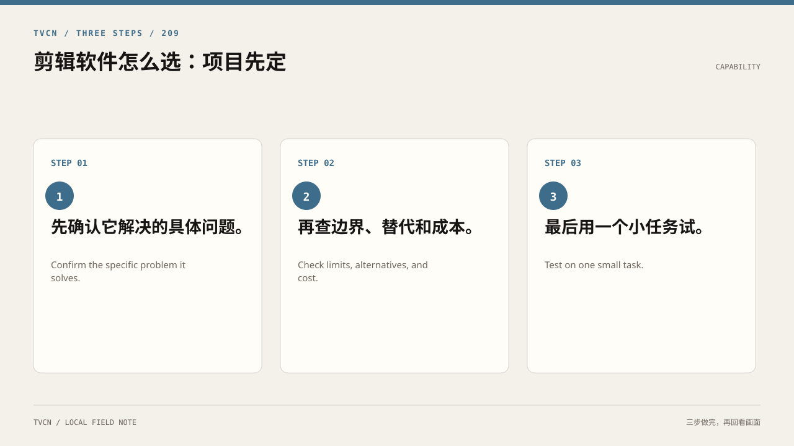

剪辑软件按项目选：团队协作、代理、调色、字幕、交付，各有所长；别按教程数量选。

<!-- DIAGRAM_START -->
<h2>图解</h2>
<figure>
  
  <figcaption>把三步按顺序做完，再回看画面或文件。</figcaption>
</figure>
<!-- DIAGRAM_END -->
<h2>现场</h2>

用同一项目素材在三个软件里各剪 1 分钟；比较代理、协作、字幕和导出，再选。

<h2>怎么做</h2>

剪辑软件按项目选：团队协作、代理、调色、字幕、交付，各有所长；别按教程数量选。
<ol><li>用同一项目素材在三个软件里各剪 1 分钟。</li><li>比较代理、协作、字幕和导出。</li><li>按项目最缺的一项做决定。</li></ol>
<h2>别踩</h2>

别按教程数量选软件；你的项目缺协作，教程再多也补不上。

<h2>验收</h2>
<ul><li>同一段素材在三个软件里各剪了 1 分钟。</li><li>代理、协作、字幕、导出四项有对比记录。</li><li>选择理由来自项目最缺的一项，不是软件热度。</li></ul>
