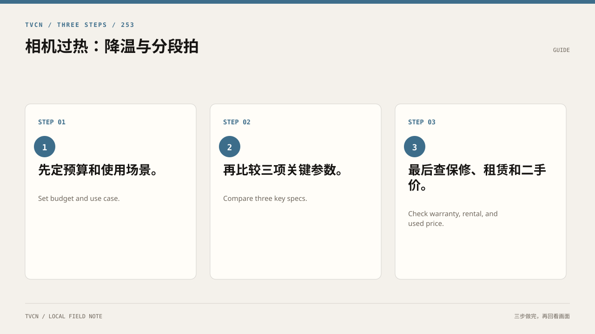

相机过热先降温、分段拍、降码率；不要用湿毛巾直接敷机身。

<!-- DIAGRAM_START -->
<h2>图解</h2>
<figure>
  
  <figcaption>把三步按顺序做完，再回看画面或文件。</figcaption>
</figure>
<!-- DIAGRAM_END -->
<h2>现场</h2>

降码率、关防抖、取下电池仓盖、分段拍；不要用湿毛巾敷机身。

<h2>怎么做</h2>

过热先降温、分段拍、降码率；不要用湿毛巾直接敷机身。
<ol><li>降分辨率或码率，关掉机身防抖和长时间监看。</li><li>取下电池仓盖或加散热片，避免太阳直晒。</li><li>每二十分钟停机五分钟，分段拍。</li></ol>
<h2>别踩</h2>

别用湿毛巾或冰袋直接敷；冷凝水会短路。

<h2>验收</h2>
<ul><li>分辨率或码率降了，防抖和长监看关了。</li><li>电池仓或散热片处理过，机器不直晒。</li><li>每二十分钟停五分钟，分段拍。</li></ul>
