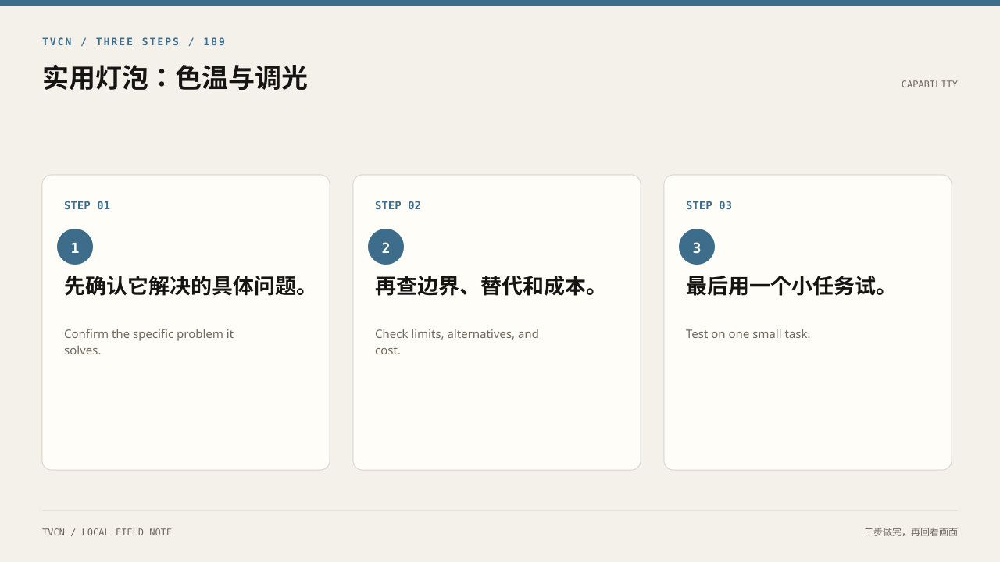

实用灯泡要能调色温和亮度，否则画面里的灯只能当道具，不能当光源。

<!-- DIAGRAM_START -->
<h2>图解</h2>
<figure>
  
  <figcaption>把三步按顺序做完，再回看画面或文件。</figcaption>
</figure>
<!-- DIAGRAM_END -->
<h2>现场</h2>

用可调色温灯泡，调到 3200K，接 dimmer 降到 30%；拍一张看它是否还能当动机。

<h2>怎么做</h2>

实用灯泡要能调色温和亮度，否则画面里的灯只能当道具，不能当光源。
<ol><li>用可调色温灯泡，调到 3200K。</li><li>接 dimmer 降到 30%。</li><li>拍一张，看它还能不能当画面里的动机光。</li></ol>
<h2>别踩</h2>

别用不可调光的家用灯泡；一亮就过曝，只能当道具。

<h2>验收</h2>
<ul><li>灯泡能调到 3200K 并接到 dimmer。</li><li>30% 亮度下画面里的灯不过曝。</li><li>它能作为动机光解释旁边的主光。</li></ul>
