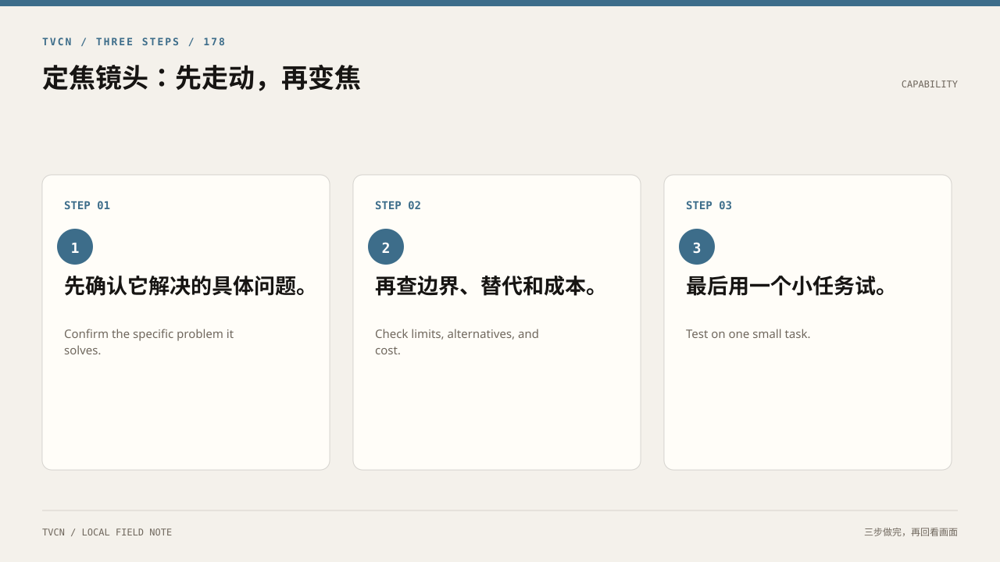

定焦不是不能变焦，它逼你走近、退后、换机位；这通常比拧变焦环更有用。

<!-- DIAGRAM_START -->
<h2>图解</h2>
<figure>
  
  <figcaption>把三步按顺序做完，再回看画面或文件。</figcaption>
</figure>
<!-- DIAGRAM_END -->
<h2>现场</h2>

用 35mm 拍同一人半身，前后走 2 米找构图；先习惯脚动，再决定买 24 还是 50。

<h2>怎么做</h2>

定焦不是不能变焦，它逼你走近、退后、换机位；这通常比拧变焦环更有用。
<ol><li>用 35mm 拍同一人半身。</li><li>前后走 2 米找构图，不用变焦。</li><li>先习惯脚动，再决定买 24 还是 50。</li></ol>
<h2>别踩</h2>

别用脚架代替走位；定焦的价值就是让你换位置。

<h2>验收</h2>
<ul><li>同一个人有至少三个走位版本，焦段没变。</li><li>能说出前后 2 米带来的背景和透视变化。</li><li>买 24 或 50 的决定来自走位经验，不是评测视频。</li></ul>
