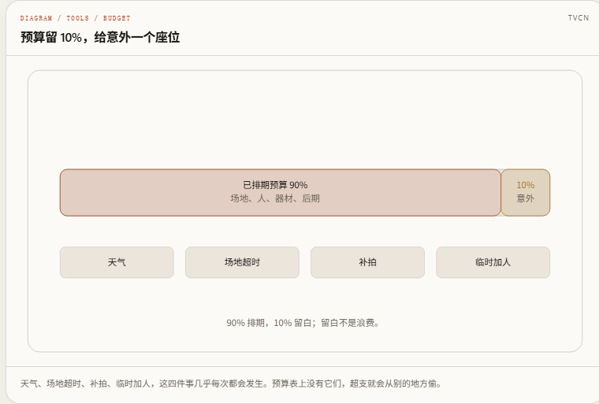

<!-- DIAGRAM_START -->
## 图解

<figure>
  
  <figcaption>天气、场地超时、补拍、临时加人，这四件事几乎每次都会发生。预算表上没有它们，超支就会从别的地方偷。</figcaption>
</figure>
<!-- DIAGRAM_END -->

## 先列四件几乎一定会发生的事

外景看天，室内看场地几点关门，演员看档期，设备看有没有备用。把这四项各写一个最坏情况，再乘以一个你承受得起的数字，放进预算。

我见过一条两天的片子，第一天下午下雨，全组等了三个小时。因为预算里留了场地续租的钱，第二天加拍半天就接上了；没留的那组，只能把夜戏改成白天，最后整条片子的情绪都变了。

## 留 10%，但写清楚怎么用

10% 不是“到时候再说”，是提前写好的三条规则：天气超时先动这一笔；演员补拍不动；设备损坏只动一半。写清楚，花的时候才不用开会吵。

这笔钱花掉，就要从别的地方减掉同等金额。否则它不是缓冲，是隐形加预算。

## 超支记在同一张纸上

每天收工前记三行：今天花了多少、比计划多多少、明天要付什么。不要等杀青才汇总，那时候已经没法改。

给甲方看的版本可以只有一页，但你自己要知道每一笔为什么超。下次报价，这些数字就是你的底气。

## 3 条验收

- 预算表里有单独一行“不可控”，金额不低于总预算 10%。
- 这笔钱的动用规则，开机前已经写下来。
- 每天收工能说出今天超了多少、为什么。
