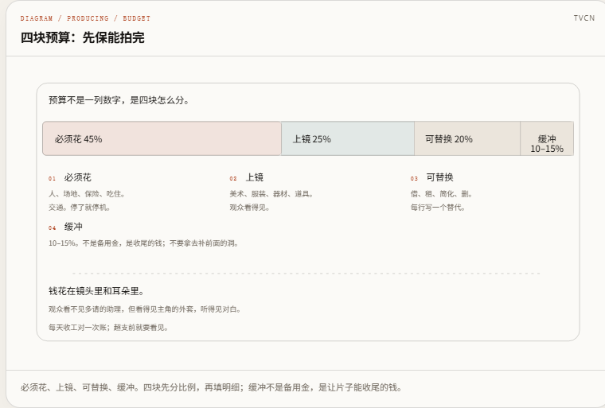

<!-- DIAGRAM_START -->
## 图解

<figure>
  
  <figcaption>必须花、上镜、可替换、缓冲。四块先分比例，再填明细；缓冲不是备用金，是让片子能收尾的钱。</figcaption>
</figure>
<!-- DIAGRAM_END -->

预算不是一列数字，是四块怎么分。先保片子能拍完，再谈好看。

## 四块：必须花、上镜、可替换、缓冲

必须花：人、场地、保险、吃住、交通。这些停了，片子就停。上镜：美术、服装、器材、道具。观众看得见的部分。可替换：能借、能租、能简化、能删的。缓冲：10–15%，不要动。

四块先分比例，再填明细。不要从“我想买什么”开始，从“哪一块不能停”开始。

## 钱花在镜头和耳朵里

观众看不见你多请了一个助理，但看得见主角的外套，听得见对白。先保画面里的东西和声音。贵器材不如对的场地，好麦克风不如安静的房间。

能借的写借，能租的写租，能用自己的写自己的。预算表上写“0”也要写清楚为什么是 0，不然拍摄当天会变成一笔新支出。

## 每一行写替代方案

每个支出项后面加一列“便宜替代”：借、租、减、换、删。拍摄前按实际更新，改一项记一次；不要动缓冲。每天收工对一次账，别等超支才发现。

预算表不是给会计看的，是给现场做决定的。哪一项可以当场砍，哪一项砍了会停机，提前写清楚。

## 检查

- 四块比例写出来了，缓冲没有被拿去补别的洞。
- 每一项都有便宜替代，不只是总价。
- 每天更新实际支出，超支前就能看见。

## 四块不是四个信封

必须花、上镜、可替换、缓冲，四块要互相能借，但借了要记。必须花是场地、保险、交通；上镜是镜头、灯、美术。

可替换是“没有也能拍”的清单：轨道可以换滑轨，摇臂可以换高台。先写替代方案，再写钱。

<!-- SOURCES_START -->
## 参考与延伸阅读

- [S41] [美国编剧工会：合同与署名资源](https://www.wga.org/) — 2026-11-26 访问。用于核对「四块：必须花、上镜、可替换、缓冲」一节的术语/方法/规则（WGA 合同与署名资源，不是中国劳动法）；不核对其中由本页经验得出的数字、型号与现场结论，也不替代测试。
- [S22] [全国人大：《民法典》](http://www.npc.gov.cn/npc/c2/c30834/202006/t20200602_306457.html) — 2026-11-26 访问。用于核对「钱花在镜头和耳朵里」一节的术语/方法/规则（《民法典》条文，不是行业惯例）；不核对其中由本页经验得出的数字、型号与现场结论，也不替代测试。
<!-- SOURCES_END -->

