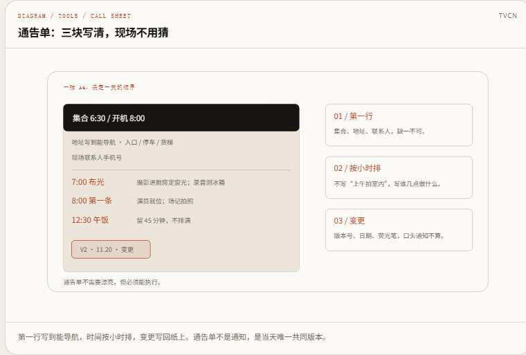

<!-- DIAGRAM_START -->
## 图解

<figure>
  
  <figcaption>第一行写到能导航，时间按小时排，变更写回纸上。通告单不是通知，是当天唯一共同版本。</figcaption>
</figure>
<!-- DIAGRAM_END -->

通告单不是发给制片主任看的表格。它是拍摄当天全组共用的唯一版本：谁几点到、去哪、带什么、出了事找谁。

## 第一行写集合，不是开机

集合时间和开机时间要分开。集合是所有人到齐、开始吃早饭、换衣服的时间；开机是第一条素材开始转的时间。把两个时间写成同一个，现场一定有人迟到，也一定有人白等。

地点写到能导航，不要只写“老城区那家面馆”。补上入口、停车、货梯、哪扇门能进。司机和第一次来的人，只看第一行就该能找到。

联系人写手机号，不要写“群里问”。再补一句天气和备用方案：下雨转室内，还是顺延。拍摄当天最怕的不是下雨，是所有人都在等一个人决定。

## 按小时排，不按部门排

不要写“上午拍室内，下午拍外景”。这种块状安排，每个部门都会按自己的理解准备。按时间写：6:30 集合，7:00 布光，8:00 第一条，12:30 午饭，13:30 转场。

每个时段后面写清谁做什么、需要什么。“7:00 摄影组进厨房，先定窗光；录音组同时测冰箱底噪；美术把餐桌上的账单换成第二版。”一句话，三个部门都知道自己该动。

给每个时段留缓冲，不要把一天排满。转场、换卡、补妆、等光，都要时间。排得越满，越容易在第一项就崩。

## 把变化留在纸上

通告单一定要有版本号和日期。V1 发下去，改了就在群里说“看 V2”，不要让大家猜以哪版为准。现场改动用荧光笔标出来，收工前发第二天的版本。

口头通知会消失在风里。谁改了时间、谁换了地点、谁需要多带一件衣服，都写回纸上。拍摄现场已经够吵，不要再加一层记忆负担。

通告单不需要漂亮，但必须能执行。一张写清的 A4，比一个精美的共享文档有用；现场没人会翻三层文件夹找今天的安排。

## 检查

- 第一行有集合时间、可导航地址、现场联系人。
- 时间表按小时排，每个时段写清谁做什么。
- 有版本号、日期和变更标记，收工前发出下一版。

<!-- DEEP_DIVE_START -->
## 深读

<strong>约 7 分钟。</strong> 通告单不是给制片看的表格，是让全组在同一个早上相信同一件事：今天几点、去哪、做什么。

### 通告单是当天的唯一事实源

现场最贵的不是器材，是十几个人各自以为知道安排。通告单必须只有一个版本：文件名带日期和版本号，发出前确认所有人收到同一版。群里说“看最新的”，等于没说；最新的是哪一版，每个人理解不同。

发版时间也要写：拍摄前一天的中午发第一版，收工前发第二天的确认版；临时改动用“V2 取代 V1”开头，不要把改动埋在聊天记录里。通告单不需要漂亮，但必须能在手机上一眼找到集合时间、地址和联系人。

### 六个字段，一行一个时间块

最小可执行的通告单只有六列：时间、场景、人物与道具、负责人、联系方式、备注。每一行是一个时间块，不是“摄影组”“录音组”这样的部门块；部门块会让每个人按自己的理解准备，时间块才会让所有人对齐。

示例：07:30 江边集合，08:00 第一条宽景，09:30 近景，11:00 转场咖啡馆，12:30 午饭。每行后面写负责人和电话，不要写“群里问”。谁负责开门、谁负责停车、谁带许可复印件，都写进备注，不要留在某个人的脑子里。

### 地址写到能导航，不是写到城市

“老城区那家面馆”不是地址。写门牌、入口、楼层、货梯、哪扇门能进、车停哪里、最近的地铁口。第一次来的人，只看这一行就应该能到；司机不需要打电话问路。

再补四个现场信息：最近的厕所在哪、最近的医院怎么走、附近哪里能买水、拍摄点有没有信号。看起来琐碎，但每一条都能在关键时刻省十分钟。地址不是给制片看的，是给那个凌晨五点出发、从没来过的人看的。

### 把时间预算写进表里

不要只写“上午拍外景”。写集合、布光、开机、第一条、转场、午饭、收工；每个阶段后面留十五到三十分钟缓冲。转场、换卡、补妆、等光都要时间，排得越满，越容易在第一项就崩。

用当天的日落时间倒排：外景最后一条必须在日落前四十分钟拍完，留出补拍和收设备的时间。午饭不要安排在十二点半才开始找餐厅；写清谁去买、几点到、在哪里吃。时间表不是愿望，是预算；预算超了，砍镜头，不要砍安全。

### 变更管理：口头通知会消失

现场改动只有三种合法方式：在纸上用荧光笔标出、在群里发“V2 取代 V1”、在收工前发第二天的确认版。口头说“下午改到三点”不算，因为总有人没听见，也总有人听见了但记成两点。

每次改动写清三件事：改了什么、为什么改、谁受影响。改了地点，要重发地址和停车；改了时间，要重排午饭和交通；改了镜头，要确认道具和演员还在不在。变更不是发一条消息，是让所有人重新对齐一次。

### 收工后的下一版

收工前花十分钟写“实际发生版”：哪一条超时、哪一个镜头没拍、明天先拍什么、谁需要早到。把实际时间写回纸上，第二天的排期才有依据；不要凭记忆重新排，记忆只会记住最顺或最惨的那一段。

通告单的终点不是发出去，是收工后还能用。第二天的版本要带上今天的教训：如果布光总是超时，就把布光提前；如果转场总是堵车，就换集合点。一张纸的价值，在于它让同一个错误只发生一次。

### 通告单，十项检查
<ul><li>文件名带日期和版本号</li><li>集合时间与开机时间分开</li><li>每行是一个时间块</li><li>六列齐全：时间场景人物负责人电话备注</li><li>地址写到门牌和入口</li><li>停车厕所医院写清</li><li>每个阶段留缓冲</li><li>外景按日落倒排</li><li>改动写清改了什么为什么谁受影响</li><li>收工前发第二天确认版</li></ul>
通告单写不清，现场就会用打电话的时间，替你做本来十分钟能做完的决定。

<!-- DEEP_DIVE_END -->
