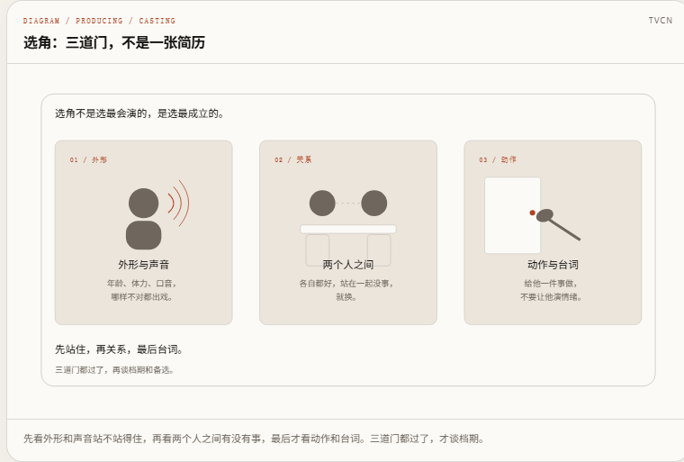

<!-- DIAGRAM_START -->
## 图解

<figure>
  
  <figcaption>先看外形和声音站不站得住，再看两个人之间有没有事，最后才看动作和台词。三道门都过了，才谈档期。</figcaption>
</figure>
<!-- DIAGRAM_END -->

## 先写他能做什么，不写他是什么样

选人之前，把人物写成动作：他几点起床、怎么开门、等人时手放哪、撒谎时看哪。不要写“温柔”“压抑”“有故事”，这些词演员只能猜。

再列三件不可替代的事：声音、走路、看人的方式。脸可以化，衣服可以换，这三样很难换。年龄感、体力、口音、职业痕迹，哪一样不对，观众第一眼就会出戏。

## 试读：给一个动作，不给一段独白

让演员做一件具体的事：等人、开门、藏东西、把杯子推远。台词只是这件事的一部分，不是表演的全部。看他在动作里怎么呼吸，怎么停，怎么不看镜头。

不要让人演“悲伤”。让他忍住一件要说的事，观众会自己补。试读时录下来，回看时关掉声音，看他有没有在“等”，还是在“表演等”。

## 两个人站在一起，才有关系

单独好看不算数。让两个人对读，看身高、语速、谁先眨眼、谁说话时另一个人在听。两个人各自都好，站在一起没有事，就换一个。

试读不要只读最激烈的一场。读一场吃饭、一场找钥匙、一场谁都不肯先挂电话。日常场面最容易看出他们是不是一家人、是不是同事、是不是旧情人。

## 档期和备选，和表演一样重要

先确认能来几天、能不能熬夜、有没有舞台或镜头经验。一个人来不了，整个日程都要改；所以每个主要角色都留一个备选。

定人之后，把角色小传、脚本、拍摄日期一起发过去。不要只发一句“就你了”，演员到现场才知道要演什么。

## 检查

- 人物小传写的是动作，不是形容词？
- 试读给的是一个动作，不是一段独白？
- 两个人站在一起，画面里有没有事发生？
- 档期、替换和角色资料，是否都落到纸上？
