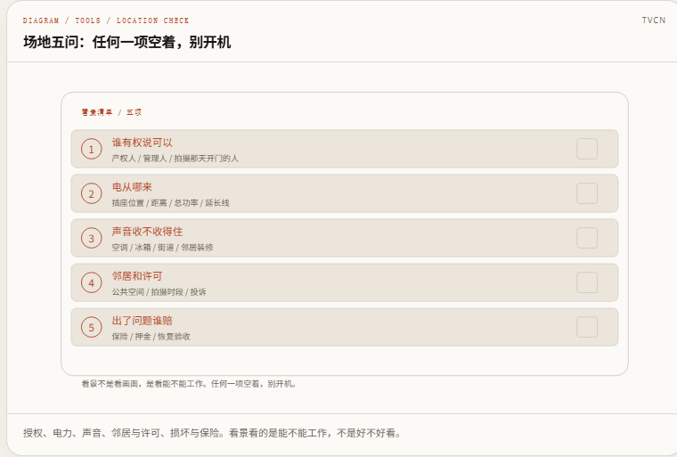

<!-- DIAGRAM_START -->
## 图解

<figure>
  
  <figcaption>授权、电力、声音、邻居与许可、损坏与保险。看景看的是能不能工作，不是好不好看。</figcaption>
</figure>
<!-- DIAGRAM_END -->

场地不是“看起来合适”就能拍。先问清五件事，再决定要不要把机器搬进去。

## 谁有权说可以

场地不是“看起来合适”就能拍。先问：谁是产权人，谁是实际管理人，谁能在拍摄那天开门。店主、租客、物业、房东，四个人里只要有一个没点头，现场就可能被停。

口头答应不算。写清日期、时段、人数、设备、用电、噪音、停车、厕所和收工恢复。签字的人要能负责，不要找一个“应该可以”的中间人。

如果拍摄会挡门、占道或影响邻居，先查当地规定。需要许可的，不要把“应该没人管”当成许可。

## 现场能不能工作

看景不要只看画面。先走一遍搬运路线：门够不够宽，楼梯能不能抬机器，电梯要不要预约，附近能不能停车。再看电：插座在哪、距离多远、总功率够不够，别到现场才发现要拉三条延长线。

声音也要看：空调、冰箱、临街车流、邻居装修。拍一条 30 秒测试，回放听底噪。画面可以补灯，声音补不了。

最后看时间：窗光几点进来、几点走，店主几点关门，邻居几点睡觉。场地的光线和营业时间，会直接改写拍摄顺序。

## 把麻烦写进计划

公共空间要查当地拍摄许可；小区和商铺提前跟邻居打招呼；买一份覆盖器材和第三者责任的保险；交押金前问清损坏怎么算。

准备一个备用场地，哪怕不用。拍摄当天把场地联系人电话写在通告单第一行；收工前恢复原状，让对方验收，再退押金。别把“下次还来”这句话说死。

场地关系是长期资产。一次收尾干净，下一次借门、借电、借安静，都会容易得多。

## 检查

- 拿到书面许可，日期、时段、人数、用电和恢复都写清。
- 搬运路线、电源和底噪都现场测过。
- 公共许可、保险和备用场地都有安排。

<!-- SOURCES_START -->
## 参考与延伸阅读

- [S41] [美国编剧工会：合同与署名资源](https://www.wga.org/) — 2026-11-26 访问。用于核对「谁有权说可以」一节的术语/方法/规则（WGA 合同与署名资源，不是中国劳动法）；不核对其中由本页经验得出的数字、型号与现场结论，也不替代测试。
- [S22] [全国人大：《民法典》](http://www.npc.gov.cn/npc/c2/c30834/202006/t20200602_306457.html) — 2026-11-26 访问。用于核对「现场能不能工作」一节的术语/方法/规则（《民法典》条文，不是行业惯例）；不核对其中由本页经验得出的数字、型号与现场结论，也不替代测试。
<!-- SOURCES_END -->

