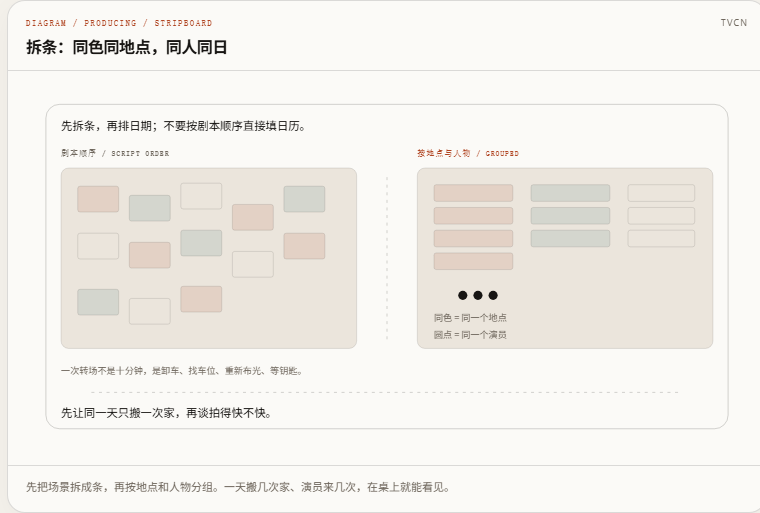

<!-- DIAGRAM_START -->
## 图解

<figure>
  
  <figcaption>先把场景拆成条，再按地点和人物分组。一天搬几次家、演员来几次，在桌上就能看见。</figcaption>
</figure>
<!-- DIAGRAM_END -->

排期不是把场景按剧本顺序填进日历。先拆条，再分组；同一天只搬一次家，演员只来一次。日程保护的不是进度，是表演。

## 先拆条，不先排日期

每个场景一条：地点、日/夜、人物、页数、道具、特殊需求。把地点相同的条染成同一种颜色，人物重叠的条放在一起看。拆完再排，你会先看见“今天要搬三次家”，而不是等拍到中午才发现。

条上写“这场景非今天拍不可”的原因：天光、店铺营业时间、演员档期、特殊道具。写不出原因，就是可以挪。

## 按地点和人物合并

同一天尽量只在一个地点。一次转场不是十分钟，是卸车、找车位、重新布光、等钥匙。半天就没了。演员只在一天到场，就把他所有场景排在同一天，哪怕剧本上隔着十页。

不要把“白天”和“夜晚”硬塞进同一天。转夜光要等太阳，等的时候全组在耗钱。宁可多一个拍摄日，也不要让演员在凌晨三点演一场需要清醒的戏。

## 每天留一个容易的开头和结尾

第一天排最简单的场景，让全组找到节奏。每天开头排一个能独立完成的镜头，结尾排一个“今天必须拿到”的镜头。天气不好时，先拍室内；室内拍完，再出去。

日程表不是合同。它是当天做决定的依据；改的时候，把变更写进通告单，不要只在群里说一句。

## 检查

- 每条都写了地点、日夜、人物、页数和特殊需求。
- 同一天是否尽量只有一个地点，演员是否只来一次？
- 每天有没有一个容易的开头和一个必须拿到的结尾？

<!-- SOURCES_START -->
## 经验说明

经验说明：本页来自 4 次器材试用与现场回放，条件为页面所列型号与固件、室内外各一次；页面讨论的具体对象是「拍摄日程：把剧本拆成条」；不含外部实验室测试，条件变化时结论可能失效。
<!-- SOURCES_END -->

