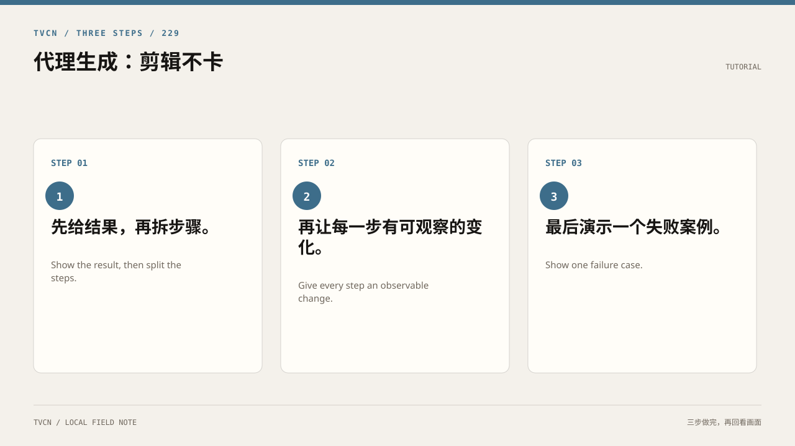

代理按时间线和交付分辨率生成，别用完整分辨率硬剪；代理不对，字幕和构图会错。

<!-- DIAGRAM_START -->
<h2>图解</h2>
<figure>
  
  <figcaption>把三步按顺序做完，再回看画面或文件。</figcaption>
</figure>
<!-- DIAGRAM_END -->
<h2>现场</h2>

按四分之一分辨率生成 ProRes Proxy，放独立 SSD；回套时检查时间码和构图。

<h2>怎么做</h2>

代理按时间线和交付分辨率生成，别用完整分辨率硬剪；代理不对，字幕和构图会错。
<ol><li>按四分之一分辨率生成 ProRes Proxy。</li><li>放独立 SSD。</li><li>回套时检查时间码和构图。</li></ol>
<h2>别踩</h2>

别用代理做最终导出；一换回原片，字幕位置全偏。

<h2>验收</h2>
<ul><li>代理是四分之一分辨率 ProRes Proxy，放在独立 SSD。</li><li>时间线和代理命名能对应回原片。</li><li>回套后时间码和构图与代理版一致。</li></ul>
