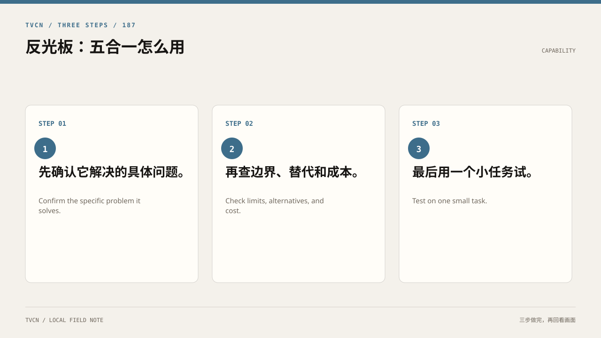

反光板五合一不是五种风格，是五种补光强度；先用白色，别一上来就银面。

<!-- DIAGRAM_START -->
<h2>图解</h2>
<figure>
  
  <figcaption>把三步按顺序做完，再回看画面或文件。</figcaption>
</figure>
<!-- DIAGRAM_END -->
<h2>现场</h2>

先用白面在阴影侧 45 度补，拍一张；不够再换银面，别一上来用金面。

<h2>怎么做</h2>

反光板五合一不是五种风格，是五种补光强度；先用白色，别一上来就银面。
<ol><li>白面放阴影侧 45 度补光，拍一张。</li><li>不够再换银面。</li><li>金面只在需要暖调时用，不要默认。</li></ol>
<h2>别踩</h2>

别一上来用金面；肤色一暖，后期很难拉回中性。

<h2>验收</h2>
<ul><li>白面 45 度补光的样张存在。</li><li>银面是在白面不够后才换的，有对比。</li><li>金面没有被默认使用，或使用时说明了暖调理由。</li></ul>
