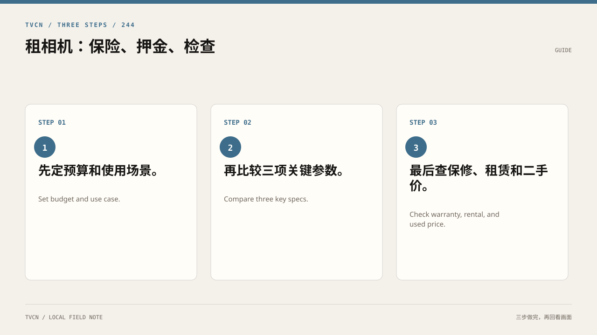

日租便宜但缺备件、取还远、保险不覆盖，停机一天可能比租金更贵。先问：有没有同型号备机、能否提前一天取、损坏责任怎么算、技术支援几点到几点。

<!-- DIAGRAM_START -->
<h2>图解</h2>
<figure>
  
  <figcaption>看“取机时拍 4K 视频：机身六面、卡口…”和“逐项试：录制、对焦、防抖、接口、电池”两处，判断这个参数能不能对应到一个具体的拍摄问题。</figcaption>
</figure>
<!-- DIAGRAM_END -->
<section><h2 id="section-1">租机先算“停机成本”，不只算日租</h2>
取机时现场测试卡槽、传感器、音频和电池；不要回到片场才发现问题。
<h2 id="section-2">边界</h2>
不要为了省租金选不熟悉的机身。现场学菜单，等于用全组的钱上课。
</section><section><h2>现场</h2>
取机时拍 4K 视频：机身六面、卡口、传感器、快门；还机前再拍一次。
</section><section><h2 id="section-3">怎么做</h2>
租机先买保险、交押金、当面检查；划痕和坏点拍视频留证。
<ol><li>取机时拍 4K 视频：机身六面、卡口、传感器、快门、屏幕。</li><li>逐项试：录制、对焦、防抖、接口、电池。</li><li>还机前再拍一次，和取机视频逐段对比。</li></ol></section><section><h2 id="section-4">别踩</h2>
别只拍照片；视频能证明划痕是原有还是新增。
</section><section><h2>判断</h2>
这一页的判断只看三条可观察的验收，不靠口号：
<ul><li><strong>1.</strong> 取机 4K 视频拍了六面、卡口、传感器、快门和屏幕。</li><li><strong>2.</strong> 录制、对焦、防抖、接口和电池逐项试过。</li><li><strong>3.</strong> 还机前再拍一次，和取机视频对比。</li></ul></section><section><h2>失败</h2>
下面任一条出现，先停，不要靠后期补：
<ul><li><strong>1.</strong> 只做到“取机 4K 视频拍了六面、卡口、传感器、快门和屏幕”的形式，换一个机位或场景就重现不了。</li><li><strong>2.</strong> 把“录制、对焦、防抖、接口和电池逐项试过”留到后期或口头解释，现场没有留下能复查的记录。</li><li><strong>3.</strong> 别只拍照片；视频能证明划痕是原有还是新增。</li></ul></section><section><h2>延伸</h2>
<strong>10 分钟练习：</strong>用现有器材做 60 秒测试，只测“取机时拍 4K 视频：机身六面、卡口…”；记下两个数字：一个是你需要的，一个是器材实际给出的。
</section>
<h2>验收</h2><ul><li>取机 4K 视频拍了六面、卡口、传感器、快门和屏幕。</li><li>录制、对焦、防抖、接口和电池逐项试过。</li><li>还机前再拍一次，和取机视频对比。</li></ul>

<!-- SOURCES_START -->
## 参考与延伸阅读

- [S31] [ARRI：电影系统](https://www.arri.com/en/cine-systems) — 2026-11-26 访问。用于核对「租机先算“停机成本”，不只算日租」一节的术语/方法/规则（ARRI 摄影机、镜头与灯光资料，不是通用拍摄教程）；不核对其中由本页经验得出的数字、型号与现场结论，也不替代测试。
- [S52] [ARRI：ALEXA 35](https://www.arri.com/en/camera-systems/cameras/legacy-camera-systems/alexa-35) — 2026-11-26 访问。用于核对「现场」一节的术语/方法/规则（ALEXA 35 官方规格，不是独立测试）；不核对其中由本页经验得出的数字、型号与现场结论，也不替代测试。
- [S53] [Sony：FX6](https://pro.sony/ue_US/products/handheld-camcorders/ilme-fx6v) — 2026-11-26 访问。用于核对「怎么做」一节的术语/方法/规则（FX6 官方规格，不是独立测试）；不核对其中由本页经验得出的数字、型号与现场结论，也不替代测试。
<!-- SOURCES_END -->

