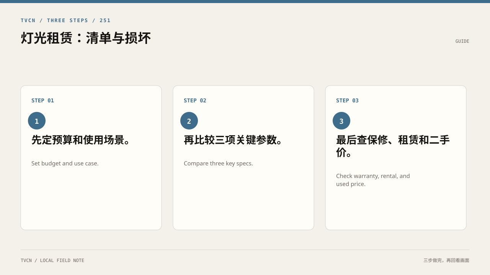

灯光租赁先列清单、试亮、拍损坏；少一个灯罩，现场就得多等一小时。

<!-- DIAGRAM_START -->
<h2>图解</h2>
<figure>
  
  <figcaption>把三步按顺序做完，再回看画面或文件。</figcaption>
</figure>
<!-- DIAGRAM_END -->
<h2>现场</h2>

列清单：灯、柔光箱、灯架、沙袋、线材；取件时逐件试亮，拍视频留证。

<h2>怎么做</h2>

灯光租赁先列清单、逐件试亮、拍损坏；少一个灯罩，现场就得多等一小时。
<ol><li>列灯、柔光箱、灯架、沙袋、线材和色纸。</li><li>取件逐件试亮，试调色温和亮度。</li><li>拍视频记录外观和配件，还件前对照。</li></ol>
<h2>别踩</h2>

别只点数量不看配件；灯罩或卡口缺一件就停。

<h2>验收</h2>
<ul><li>清单含灯、柔光箱、灯架、沙袋、线材和色纸。</li><li>逐件试亮，试过色温和亮度。</li><li>拍视频记录外观和配件，还件前对照。</li></ul>
