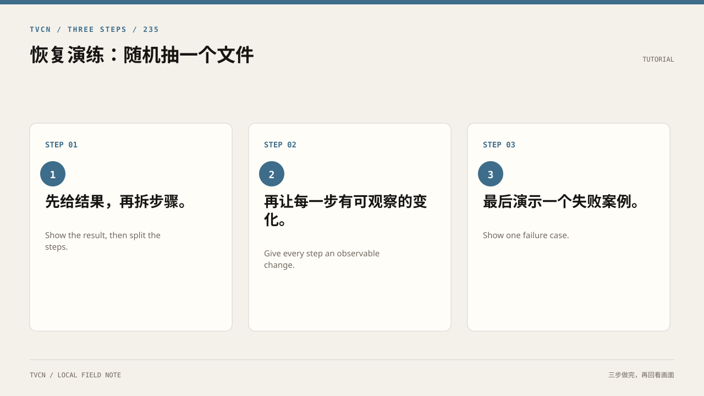

恢复演练随机抽一个文件，从备份打开；打不开的备份等于没有。

<!-- DIAGRAM_START -->
<h2>图解</h2>
<figure>
  
  <figcaption>把三步按顺序做完，再回看画面或文件。</figcaption>
</figure>
<!-- DIAGRAM_END -->
<h2>现场</h2>

随机抽一个文件，从备份拷到另一台机器，打开播放；失败就重做备份。

<h2>怎么做</h2>

恢复演练随机抽一个文件，从备份打开；打不开的备份等于没有。
<ol><li>随机抽一个文件。</li><li>从备份拷到另一台机器。</li><li>打开播放，失败就重做备份。</li></ol>
<h2>别踩</h2>

别只看备份软件打绿勾；没恢复过，就不知道能不能打开。

<h2>验收</h2>
<ul><li>随机抽取，不是挑最熟悉的文件。</li><li>恢复到另一台机器，不是原机原路径。</li><li>文件能打开播放；失败时有重做记录。</li></ul>
