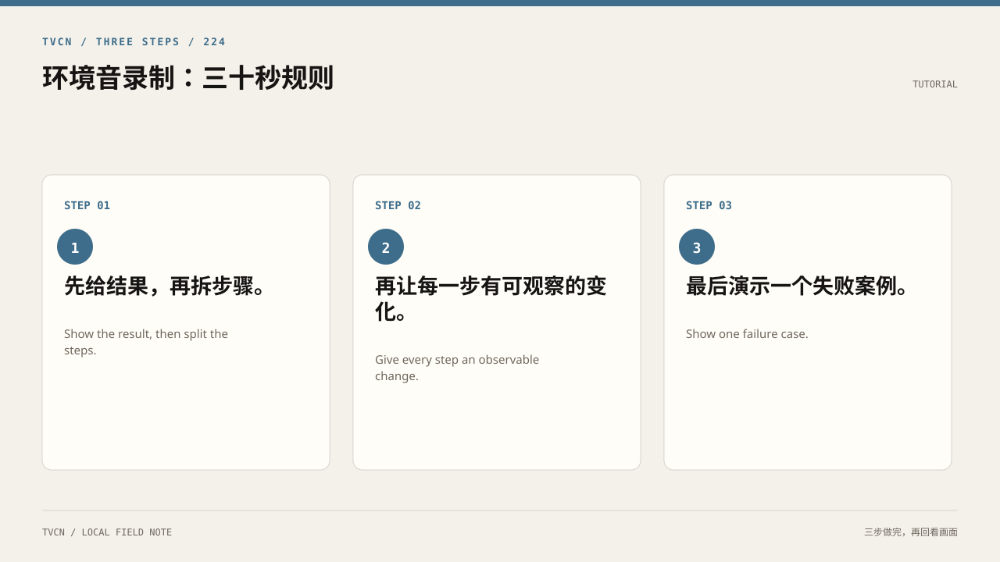

每个场景录三十秒环境声，全组安静；没有它，剪对话会像在真空里。

<!-- DIAGRAM_START -->
<h2>图解</h2>
<figure>
  
  <figcaption>把三步按顺序做完，再回看画面或文件。</figcaption>
</figure>
<!-- DIAGRAM_END -->
<h2>现场</h2>

每场录 30 秒，全组不动；录完听回放，确认没有空调和冰箱声。

<h2>怎么做</h2>

每个场景录三十秒环境声，全组安静；没有它，剪对话会像在真空里。
<ol><li>每场录 30 秒。</li><li>全组不动、不说话。</li><li>录完听回放，确认没有空调和冰箱声。</li></ol>
<h2>别踩</h2>

别在转场时顺手录环境；脚步声和说话会一起进去。

<h2>验收</h2>
<ul><li>每个场景都有 30 秒环境声文件。</li><li>录制时全组静止，没有脚步和说话。</li><li>回放里没有空调或冰箱的持续低频。</li></ul>
