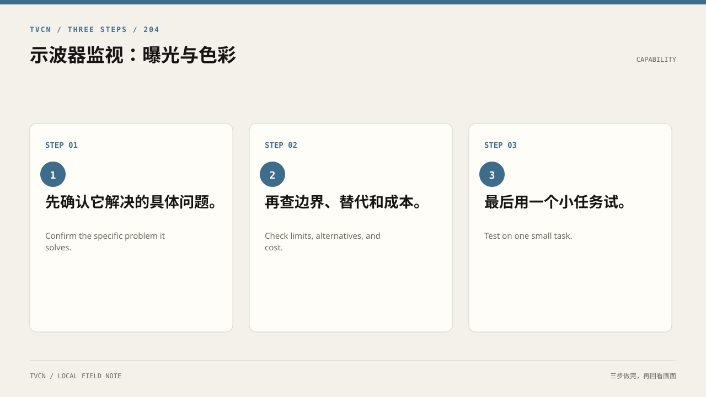

示波器只能读信号，不能判断构图和表演。把波形当成“曝光正确”的唯一标准，会让高光保住了、脸却没有方向。

<!-- DIAGRAM_START -->
<h2>图解</h2>
<figure>
  
  <figcaption>看“示波器切到波形和矢量”和“拍灰卡”两处，判断这个参数能不能对应到一个具体的拍摄问题。</figcaption>
</figure>
<!-- DIAGRAM_END -->
<section><h2 id="section-1">选型先看什么</h2><ul><li><strong>波形与矢量：</strong>必须能同时看亮度波形和矢量示波器；只有直方图不够判断肤色和黑位。</li><li><strong>输入与缩放：</strong>确认 3G/6G/12G SDI 或 HDMI 版本，以及能否把关键区域放大到 1:1 像素。</li><li><strong>供电与亮度：</strong>现场要能外接电源或长时间电池；屏幕亮度要能对抗外景，而不是只在暗房好看。</li></ul><h2 id="section-2">它不能替你做的事</h2></section><section><h2 id="section-3">现场</h2>
把示波器切到波形和矢量，拍灰卡；黑位 0、白位 100、肤色线在靶心。
</section><section><h2 id="section-4">怎么做</h2><ol><li>示波器切到波形和矢量。</li><li>拍灰卡。</li><li>黑位 0、白位 100、肤色线落在靶心。</li></ol></section><section><h2 id="section-5">别踩</h2>
别只看直方图；肤色偏绿时，直方图完全正常。
</section>
<h2>验收</h2><ul><li>波形和矢量两个视图都打开过。</li><li>灰卡黑位 0、白位 100 有读数。</li><li>肤色线落在靶心附近，偏移能被指出。</li></ul>

<!-- SOURCES_START -->
## 经验说明

经验说明：本页来自 3 次器材试用与现场回放，条件为页面所列型号与固件、室内外各一次；页面讨论的具体对象是「示波器监视：曝光与色彩」；不含外部实验室测试，条件变化时结论可能失效。
<!-- SOURCES_END -->

