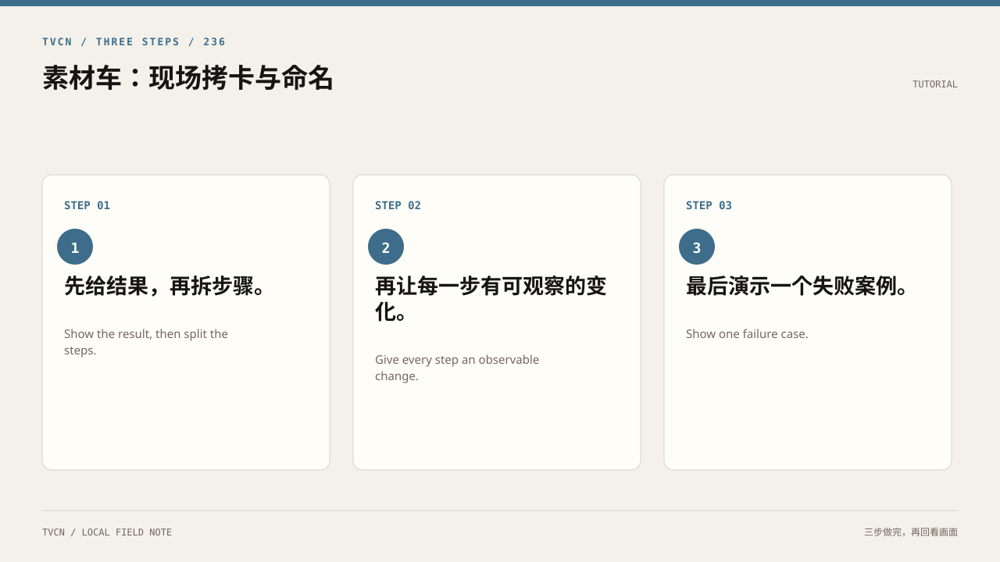

拷卡不是拖进文件夹就完。用校验和工具核对源卡与目标盘，生成一份清单；三份副本分别放在机身、现场盘和离线盘。没有校验和的“拷贝完成”不算备份。

<!-- DIAGRAM_START -->
<h2>图解</h2>
<figure>
  
  <figcaption>看“现场设一张桌子：读卡器、SSD、笔记…”和“拷完校验 checksum”两处，判断这个参数能不能对应到一个具体的拍摄问题。</figcaption>
</figure>
<!-- DIAGRAM_END -->
<section><h2 id="section-1">素材站先做“校验和”，再做“三份”</h2>
每张卡拷完立刻抽一个文件回放；确认文件名、时长和声音都对，再格式化卡。
<h2>边界</h2>
素材站不是剪辑台。不要在现场盘上直接剪；先做副本和代理，再开工程，避免误删和性能瓶颈。
</section><section><h2 id="section-2">现场</h2>
现场设一张桌子：读卡器、SSD、笔记本、标签；拷完校验 checksum，再命名。
</section><section><h2 id="section-3">怎么做</h2><ol><li>现场设一张桌子：读卡器、SSD、笔记本、标签。</li><li>拷完校验 checksum。</li><li>再按场次镜号命名。</li></ol></section><section><h2 id="section-4">别踩</h2>
别把卡带回机房再整理；现场不命名，后期要花一倍时间认素材。
</section><section><h2>判断</h2>
这一页的判断只看三条可观察的验收，不靠口号：
<ul><li><strong>1.</strong> 现场有读卡器、SSD、笔记本和标签的工作台。</li><li><strong>2.</strong> 每张卡拷完做 checksum 校验。</li><li><strong>3.</strong> 素材按场次镜号命名，回机房不用再认。</li></ul></section><section><h2>失败</h2>
下面任一条出现，先停，不要靠后期补：
<ul><li><strong>1.</strong> 只做到“现场有读卡器、SSD、笔记本和标签的工作台”的形式，换一个机位或场景就重现不了。</li><li><strong>2.</strong> 把“每张卡拷完做 checksum 校验”留到后期或口头解释，现场没有留下能复查的记录。</li><li><strong>3.</strong> 别把卡带回机房再整理；现场不命名，后期要花一倍时间认素材。</li></ul></section><section><h2>延伸</h2>
<strong>10 分钟练习：</strong>用现有器材做 60 秒测试，只测“现场设一张桌子：读卡器、SSD、笔记…”；记下两个数字：一个是你需要的，一个是器材实际给出的。
</section>
<h2>验收</h2><ul><li>现场有读卡器、SSD、笔记本和标签的工作台。</li><li>每张卡拷完做 checksum 校验。</li><li>素材按场次镜号命名，回机房不用再认。</li></ul>

<!-- SOURCES_START -->
## 参考与延伸阅读

- [S57] [Blackmagic：URSA Mini Pro 12K 规格](https://www.blackmagicdesign.com/products/blackmagicursaminipro/techspecs) — 2026-11-26 访问。用于核对「素材站先做“校验和”，再做“三份”」一节的术语/方法/规则（URSA Mini Pro 12K 官方规格，不是独立测试）；不核对其中由本页经验得出的数字、型号与现场结论，也不替代测试。
- [S35] [Avid：资源中心](https://www.avid.com/resource-center) — 2026-11-26 访问。用于核对「现场」一节的术语/方法/规则（Avid 资源中心，不是独立评测）；不核对其中由本页经验得出的数字、型号与现场结论，也不替代测试。
<!-- SOURCES_END -->

