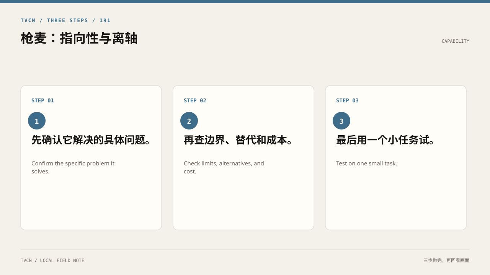

室内硬墙、多人围坐或需要隐形收音时，枪麦不如领夹。不要用一支枪麦解决所有场景。

<!-- DIAGRAM_START -->
<h2>图解</h2>
<figure>
  
  <figcaption>看“在 1 米、2 米、3 米各录一句”和“回放听指向性和环境比例”两处，判断这个参数能不能对应到一个具体的拍摄问题。</figcaption>
</figure>
<!-- DIAGRAM_END -->
<section><h2 id="section-1">选型先看什么</h2><ul><li><strong>指向与离轴：</strong>确认拾音角度和离轴衰减；太窄会漏掉移动，太宽会收进环境。</li><li><strong>供电与输出：</strong>确认幻象电源、电池和输出电平；直接进相机可能增益不够。</li><li><strong>防风与杆：</strong>枪麦必须配笼式防风、毛衣和吊杆；没有避震，手持噪声会全进对白。</li></ul></section><section><h2 id="section-3">现场</h2>
在 1 米、2 米、3 米各录一句；回放听指向性，超过 2 米就换领夹或吊杆。
</section><section><h2 id="section-4">怎么做</h2><ol><li>在 1 米、2 米、3 米各录一句。</li><li>回放听指向性和环境比例。</li><li>超过 2 米就换领夹或吊杆。</li></ol></section><section><h2 id="section-5">别踩</h2>
别用后期降噪救远距离枪麦；对白已经被环境盖住了。
</section>
<h2>验收</h2><ul><li>1 米、2 米、3 米各有一条同台词录音。</li><li>回放能听出超过 2 米后对白被环境盖住。</li><li>超过 2 米的镜头准备了领夹或吊杆替代。</li></ul>

> 意图分工：本页负责「枪麦：指向性与离轴」的可执行细节；同集群先读 <a href="https://tools.tvcn.org/article/lav-hidden/">领夹藏麦：衣领、头发、胶带</a> 建立总判断，再回到本页。

<!-- INTENT_SCOPE -->

<section><h2>不解决什么</h2>
本页只比较「枪麦：指向性与离轴」的能力与关键参数，不解决具体型号的实时价格、保修、卡口/固件兼容和个体品控；这些要看官方规格页、租赁商实测和退货条款。若问题涉及拍摄方案、预算或现场故障，先回到对应方法页。
</section>
<!-- SOURCES_START -->
## 经验说明

经验说明：本页来自 3 次器材试用与现场回放，条件为页面所列型号/固件、室内外各一次；只讨论「枪麦：指向性与离轴」的选型与使用边界，不含外部实验室测试；不适用于未列型号、个体品控、保修/租赁合同与安全认证。
<!-- SOURCES_END -->

