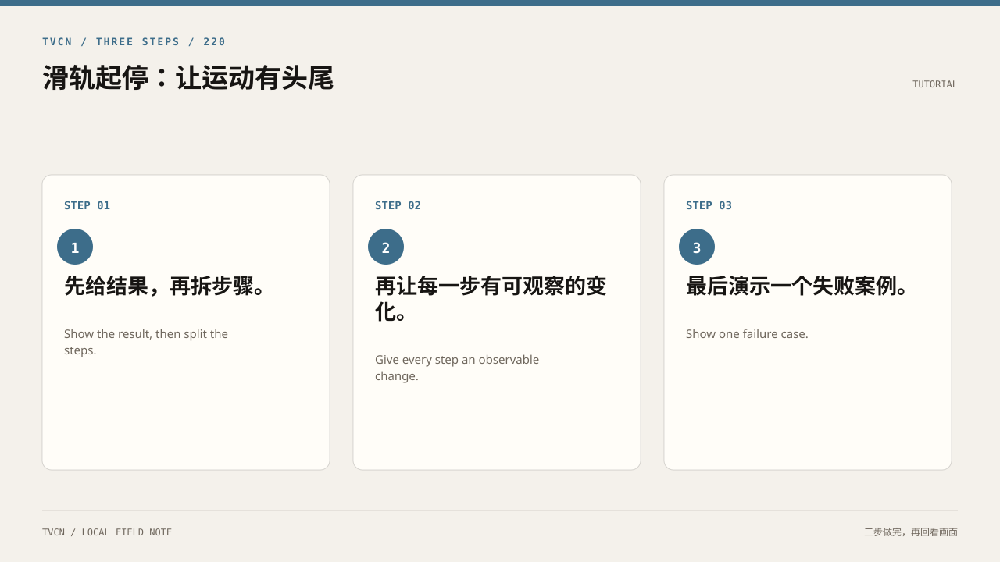

滑轨镜头要有头、身、尾：起幅停半秒、过程匀、落幅停半秒。

<!-- DIAGRAM_START -->
<h2>图解</h2>
<figure>
  
  <figcaption>把三步按顺序做完，再回看画面或文件。</figcaption>
</figure>
<!-- DIAGRAM_END -->
<h2>现场</h2>

起幅停 1 秒、匀速 3 秒、落幅停 1 秒；用监视器看起停，不要用手腕硬掰。

<h2>怎么做</h2>

滑轨镜头要有头、身、尾：起幅停半秒、过程匀、落幅停半秒。
<ol><li>起幅停 1 秒。</li><li>匀速走 3 秒。</li><li>落幅停 1 秒，用监视器看起停，不要用手腕硬掰。</li></ol>
<h2>别踩</h2>

别一开机就推；没有起幅停顿，剪辑时找不到入点。

<h2>验收</h2>
<ul><li>起幅 1 秒、过程 3 秒、落幅 1 秒的时间码可查。</li><li>监视器里起停没有突然加速或急停。</li><li>运动靠滑轨，不靠手腕硬掰。</li></ul>
