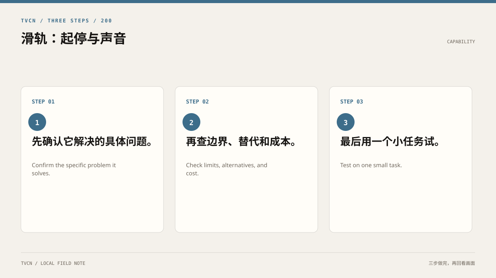

需要长距离、快速移动或不平地面时，滑轨不如稳定器或车拍。不要为了一个横移镜头搭半小时轨道。

<!-- DIAGRAM_START -->
<h2>图解</h2>
<figure>
  
  <figcaption>看“滑轨上放一杯水，慢起慢停”和“回放听轮子声”两处，判断这个参数能不能对应到一个具体的拍摄问题。</figcaption>
</figure>
<!-- DIAGRAM_END -->
<section><h2 id="section-1">选型先看什么</h2><ul><li><strong>长度与承重：</strong>按最重配置选，轨道越长越难调平；先确认拍摄距离，不要买最长。</li><li><strong>起停与摩擦：</strong>手推时能匀速起步、停下不抖；阻尼太大或太小都会让运动难看。</li><li><strong>声音与架设：</strong>轨道接头、滑轮和脚架要安静；室内对白现场，滑轨噪声会被收进去。</li></ul><h2 id="section-2">什么时候不要用</h2></section><section><h2 id="section-3">现场</h2>
在滑轨上放一杯水，慢起慢停；回放听轮子声，如果进对白，铺毛巾或换静音轮。
</section><section><h2 id="section-4">怎么做</h2><ol><li>滑轨上放一杯水，慢起慢停。</li><li>回放听轮子声。</li><li>如果进对白，铺毛巾或换静音轮。</li></ol></section><section><h2 id="section-5">别踩</h2>
别用手腕硬推滑轨；起停一急，水杯和画面一起晃。
</section>
<h2>验收</h2><ul><li>水杯测试里起停没有洒水或明显晃动。</li><li>回放能判断轮子声是否进对白。</li><li>有噪声时已铺毛巾或换静音轮，并有对比。</li></ul>

> 意图分工：本页负责「滑轨：起停与声音」的可执行细节；同集群先读 <a href="https://tools.tvcn.org/article/gimbal-balance/">稳定器调平：开机前五分钟</a> 建立总判断，再回到本页。

<!-- INTENT_SCOPE -->

<!-- SOURCES_START -->
## 经验说明

经验说明：本页来自 7 次器材试用与现场回放，条件为页面所列型号与固件、室内外各一次；页面讨论的具体对象是「滑轨：起停与声音」；不含外部实验室测试，条件变化时结论可能失效。
<!-- SOURCES_END -->

