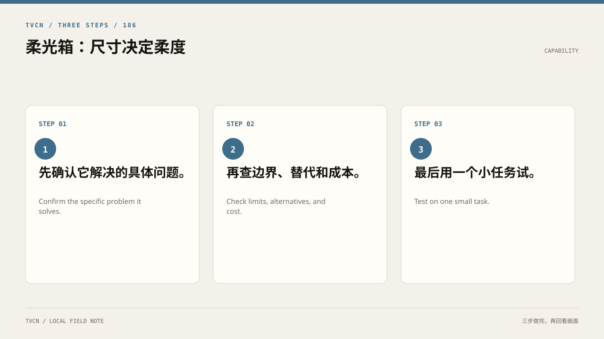

需要硬光、清晰影子或远距离投射时，柔光箱会把方向打散。不要用它解决所有布光问题。

<!-- DIAGRAM_START -->
<h2>图解</h2>
<figure>
  
  <figcaption>看“同一盏灯，柔光箱分别放 0.8 米和…”和“各拍一张”两处，判断这个参数能不能对应到一个具体的拍摄问题。</figcaption>
</figure>
<!-- DIAGRAM_END -->
<section><h2 id="section-1">选型先看什么</h2><ul><li><strong>尺寸：</strong>柔度来自发光面积和距离，不是品牌；小房间放不下 120cm 箱时，先用小箱贴近。</li><li><strong>卡口与结构：</strong>确认卡口、快装、格栅和柔光布；难装的柔光箱在现场会被少用。</li><li><strong>散热：</strong>高功率 COB 加小柔光箱会积热；确认开孔和灯体散热方向。</li></ul></section><section><h2 id="section-3">现场</h2>
同一盏灯，柔光箱分别放 0.8 米和 1.5 米，各拍一张；比较影子边缘和眼神光大小。
</section><section><h2 id="section-4">怎么做</h2><ol><li>同一盏灯，柔光箱分别放 0.8 米和 1.5 米。</li><li>各拍一张。</li><li>比较影子边缘和眼神光大小。</li></ol></section><section><h2 id="section-5">别踩</h2>
别靠换更贵的灯求柔；先把柔光箱靠近，效果更直接。
</section>
<h2>验收</h2><ul><li>0.8 米和 1.5 米各有一张同灯样张。</li><li>近的那张影子边缘更软，能看出来。</li><li>眼神光大小随距离变化，有对比。</li></ul>

> 意图分工：本页负责「柔光箱：尺寸决定柔度」的可执行细节；同集群先读 <a href="https://tools.tvcn.org/article/buy-light-kit/">购买灯光套装：先买柔，再买亮</a> 建立总判断，再回到本页。

<!-- INTENT_SCOPE -->

<section><h2>不解决什么</h2>
本页只比较「柔光箱：尺寸决定柔度」的能力与关键参数，不解决具体型号的实时价格、保修、卡口/固件兼容和个体品控；这些要看官方规格页、租赁商实测和退货条款。若问题涉及拍摄方案、预算或现场故障，先回到对应方法页。
</section>
<!-- SOURCES_START -->
## 经验说明

经验说明：本页来自 7 次器材试用与现场回放，条件为页面所列型号/固件、室内外各一次；只讨论「柔光箱：尺寸决定柔度」的选型与使用边界，不含外部实验室测试；不适用于未列型号、个体品控、保修/租赁合同与安全认证。
<!-- SOURCES_END -->

