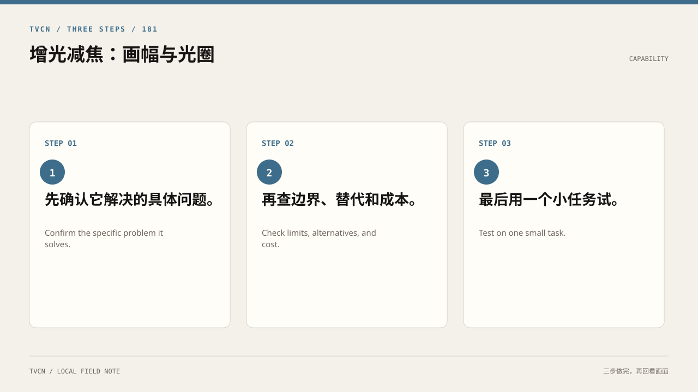

需要原生自动对焦、防抖或轻量时，直接买对应卡口的镜头更可靠。增光减焦是转接方案，不是无代价升级。

<!-- DIAGRAM_START -->
<h2>图解</h2>
<figure>
  
  <figcaption>看“同机位同镜头，装与不装各拍一张”和“比较视角、进光量和四角锐度”两处，判断这个参数能不能对应到一个具体的拍摄问题。</figcaption>
</figure>
<!-- DIAGRAM_END -->
<section><h2 id="section-1">选型先看什么</h2><ul><li><strong>画幅与倍率：</strong>确认全画幅镜头到 APS-C/M43 的倍率，以及是否覆盖传感器；错误倍率会暗角。</li><li><strong>光圈与对焦：</strong>增光会改变等效光圈和景深；自动对焦速度与兼容性要实测。</li><li><strong>卡口与间隙：</strong>确认镜头后组不碰增光片；某些广角镜头无法使用。</li></ul><h2 id="section-2">什么时候不要用</h2></section><section><h2 id="section-3">现场</h2>
同机位同镜头，装与不装各拍一张；比较视角、进光量和四角锐度，边缘软就降一档。
</section><section><h2 id="section-4">怎么做</h2><ol><li>同机位同镜头，装与不装各拍一张。</li><li>比较视角、进光量和四角锐度。</li><li>边缘软就降一档，别硬开。</li></ol></section><section><h2 id="section-5">别踩</h2>
别把增光减焦当免费光圈；边缘软和暗角是它的账。
</section>
<h2>验收</h2><ul><li>装与不装各有一张同机位对比。</li><li>视角变宽和进光量提升能被指出。</li><li>四角锐度有检查，软了有降一档的对照。</li></ul>
